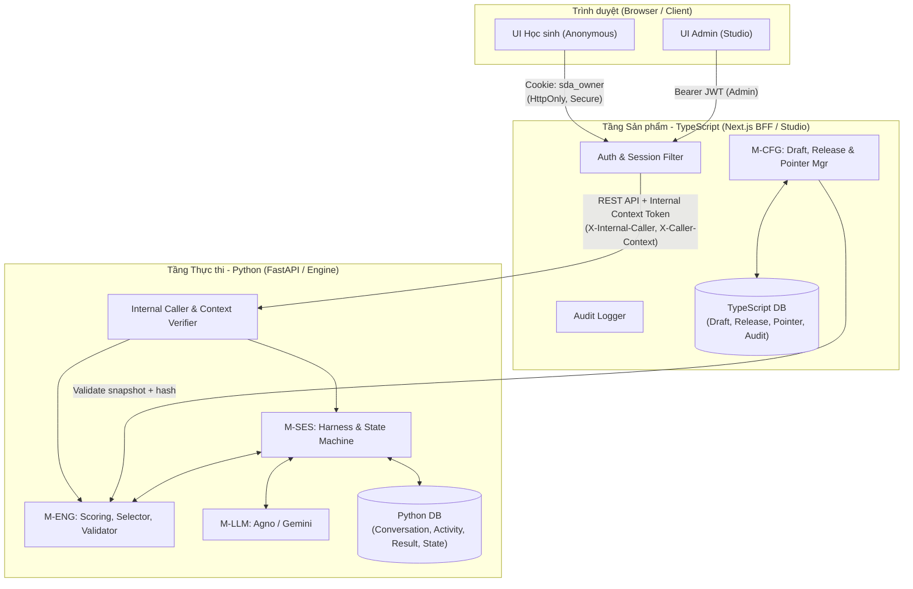
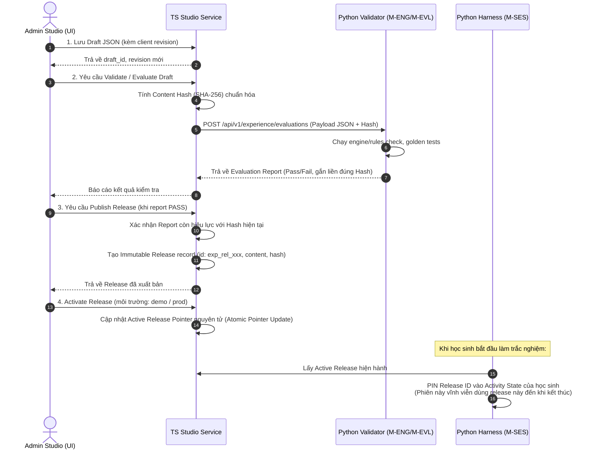

# ADR-001: Ranh giới Auth, Persistence và Release Delivery (TS Product Layer vs Python Execution Layer)

- **Trạng thái:** PROPOSED (Đề xuất cho Baseline G0-03 / DEC-07)
- **Ngày:** 2026-10-13
- **Quyết định liên quan:** DEC-01, DEC-02, DEC-03, DEC-05, DEC-07, DEC-08
- **Module liên quan:** M-AUTH, M-CFG, M-ADM (TypeScript Layer) / M-SES, M-ENG, M-EVL (Python Layer)
- **Người tham gia review:** Dev A (TypeScript Product), Dev B (Python Execution), Technical Lead, QA / Security Reviewer

**Tài liệu liên quan:** [ADR-002 — Adaptive RIASEC](ADR-002-adaptive-riasec-scoring.md) mô tả profile assessment mới sử dụng ranh giới TS–Python ở đây. Người dùng duyệt thiết kế ADR-002 không thay trạng thái PROPOSED của ADR-001; auth, TTL/retention và migration vẫn theo phạm vi quyết định riêng.

---

## 1. Ngữ cảnh & Đặt vấn đề (Context)

Dự án **Student Discovery Agent (SDA)** phân tách hệ thống thành 2 tầng logic chính:
1. **Tầng Sản phẩm & Quản trị (Product & Studio Layer - TypeScript / Next.js):**
   - Đóng vai trò Backend-for-Frontend (BFF), cổng giao tiếp với trình duyệt (Web Client).
   - Quản lý trải nghiệm Admin Studio (UC-06, UC-07): tạo/chỉnh sửa draft cấu hình, gửi thẩm định validation/evaluation, xuất bản (publish) release bất biến, quản lý pointer active và rollback.
   - Quản lý thông tin xác thực Admin (JWT scaffold) và quản lý phiên vô danh của học sinh qua Cookie.
2. **Tầng Thực thi (Execution & AI Engine Layer - Python / FastAPI):**
   - Đóng vai trò State Machine & AI Engine: lưu trữ session chat, lượt hội thoại (turns), lịch sử câu hỏi/đáp án, tính toán điểm số (scoring), gọi LLM adapter (Agno / Gemini).
   - Cung cấp dịch vụ kiểm tra tính hợp lệ của cấu hình (Configuration Validator & Evaluator).

Nếu không có ranh giới kiến trúc rõ ràng, hệ thống sẽ gặp các rủi ro nghiêm trọng:
- Hai bên truy cập chéo cơ sở dữ liệu (Database coupling).
- Lẫn lộn quyền sở hữu session giữa học sinh (Anonymous) và quản trị viên (Admin).
- Trình duyệt có thể gửi giả mạo `owner_id` hoặc vượt qua xác thực để đọc/sửa dữ liệu của học sinh khác (IDOR).
- Release cấu hình bị ghi đè ngầm làm hỏng trạng thái session đang chạy của học sinh (Race conditions / Data inconsistency).

---

## 2. Các quyết định kiến trúc (Decisions)



### 2.1. Quyết định 1: Ranh giới Auth & Ownership (M-AUTH / DEC-07)

#### A. Xác thực Học sinh (Student Anonymous Flow)
1. **Không yêu cầu tài khoản:** Học sinh truy cập không cần đăng ký tài khoản (Zero-friction UX).
2. **Khởi tạo Owner:**
   - Trình duyệt gửi `POST /api/v1/conversations`.
   - Nếu chưa có cookie định danh, tầng TS sinh mã `owner_id` (UUIDv4 ngẫu nhiên).
   - TS tạo cookie định danh:
     ```http
     Set-Cookie: sda_owner=<opaque_secure_token>; Path=/api/v1; HttpOnly; SameSite=Lax; Secure; Max-Age=2592000
     ```
   - Token trong cookie là chuỗi được ký (Signed token chứa `owner_id` + `issued_at` + `exp`) bởi khóa bí mật của hệ thống (`COOKIE_SIGNING_SECRET`), ngăn chặn học sinh tự ý sửa đổi `owner_id`.
3. **Kiểm tra quyền sở hữu:**
   - Mọi request tiếp theo (`GET /conversations/{id}`, `POST /conversations/{id}/turns`, `GET /activities/{id}`, `GET /results/{id}`) bắt buộc phải có cookie `sda_owner`.
   - Hệ thống so khớp `owner_id` giải mã từ cookie với `owner_id` liên kết của Conversation/Activity. Nếu không khớp hoặc cookie hết hạn: trả về `401 Unauthorized` hoặc `403 Forbidden`. Không bao giờ chỉ tin cậy `conversation_id` từ URL path.

#### B. Xác thực Admin Studio
1. Kế thừa cơ chế xác thực Scaffold hiện có (`app/modules/admin` và `admin-auth-api.yaml`).
2. Quản trị viên đăng nhập nhận `access_token` (Bearer JWT).
3. Tầng TS kiểm tra JWT và phân quyền RBAC:
   - `experience.config.write`: Cho phép sửa draft.
   - `experience.config.validate`: Cho phép chạy validation.
   - `experience.config.evaluate`: Cho phép chạy evaluation.
   - `experience.release.publish`: Cho phép xuất bản release mới.
   - `experience.release.activate`: Cho phép đổi active release / rollback.
   - `experience.audit.read`: Cho phép xem lịch sử log.

   Tên quyền thống nhất theo `x-required-permission` trong OpenAPI (`contracts/openapi/public/*.yaml`).

#### C. Giao tiếp Service-to-Service: TypeScript $\rightarrow$ Python Execution Layer
1. Python Execution Layer **không mở public trực tiếp ra Internet**; chỉ nhận request từ tầng TS (qua mạng nội bộ hoặc Docker network).
2. Khi TS chuyển tiếp (proxy) hoặc gọi API sang Python, TS phải đính kèm Header nội bộ có chữ ký xác thực:
   - `X-Internal-Caller: sda-product-bff`
   - `X-Caller-Context: <JWT hoặc Token HMAC chứa { caller_type: "student"|"admin", owner_id: "...", user_id: "...", roles: [...] }>`
   - `X-Internal-Signature: sha256_hmac(body, INTERNAL_SHARED_SECRET)` (hoặc token asymmetric RS256).
3. **Phía Python:**
   - Middleware bắt buộc xác thực token nội bộ và tính toàn vẹn của payload.
   - Tuyệt đối **không** đọc `owner_id` từ query parameter hay body payload do client tự khai báo nếu không khớp với `X-Caller-Context`.
   - Giữ nguyên `idempotency_key`, `revision`, và payload nguyên vẹn từ client chuyển tiếp xuống.

---

### 2.2. Quyết định 2: Ranh giới Persistence & Migration

| Tiêu chí | Tầng TypeScript (Product & Studio) | Tầng Python (Execution & Session) |
| :--- | :--- | :--- |
| **Phạm vi dữ liệu** | • Experience Metadata<br>• Draft configurations (JSON snapshot)<br>• Immutable Releases<br>• Active Release Pointers (per environment: `demo`, `prod`)<br>• Admin Audit Logs | • Conversations & Lịch sử tin nhắn<br>• Activities (`personality_assessment`)<br>• Session States & Answers (Scored answers)<br>• Projection & Kết quả bài test (Results / Card data)<br>• Cache tính toán tạm thời |
| **Cơ sở dữ liệu** | Database riêng hoặc Schema riêng (`product_schema`) | Database riêng hoặc Schema riêng (`execution_schema`) |
| **Công cụ Migration** | Công cụ của TS (Prisma / Drizzle / Node migration runner) | **Alembic** (`app/db/migrations`) |
| **Nguyên tắc cô lập** | **Không truy cập trực tiếp DB Python.** Muốn lấy thông tin session/state phải gọi qua REST API của Python. | **Không truy cập trực tiếp DB TypeScript.** Muốn lấy nội dung release cấu hình phải gọi qua Contract hoặc đọc qua Release Cache bất biến. |

---

### 2.3. Quyết định 3: Ranh giới Release Delivery & Hash Lifecycle

Hệ thống tuân thủ chặt chẽ định nghĩa **QT-06 (Definition, Draft, Release và Pin)** trong SRS:



1. **Chuẩn hóa Hashing (Deterministic Content Hashing):**
   - Nội dung cấu hình draft được chuẩn hóa theo RFC 8785 (JSON Canonicalization Scheme), như quy ước đã ghi trong docs `user-api.yaml`, trước khi hash bằng `SHA-256`.
   - Mã băm được đặt tên: `sha256:<hash_hex>`.
2. **Tính bất biến của Release:**
   - Một khi bản ghi Release đã được tạo trong bảng `experience_releases`, **không được phép UPDATE hoặc DELETE**.
   - Nếu muốn sửa lỗi nội dung: Admin phải sửa trên Draft $\rightarrow$ sinh Hash mới $\rightarrow$ re-validate $\rightarrow$ publish một Release ID mới.
3. **Cơ chế Pinning vào Session (Pin-to-Session):**
   - Mỗi khi học sinh khởi tạo một Activity mới (`POST /conversations/{id}/activities`), tầng thực thi Python sẽ đọc `active_release_id` tại thời điểm đó và ghi cố định (`pinned_release_id`) vào Activity record.
   - Kể cả khi Admin kích hoạt Release mới (`activate`) hoặc hoàn tác về bản cũ (`rollback`), các session đang diễn ra vẫn giữ nguyên cấu trúc câu hỏi và bộ luật tính điểm ban đầu. Không gây nhảy câu hoặc hỏng điểm số của bài đang làm.

---

## 3. Ma trận kiểm thử chấp nhận & Fixtures (Acceptance Test AT-19 & AT-20)

Để nghiệm thu task G0-03, bộ hợp đồng API và fixtures kiểm thử phải bảo đảm:

| Mã Test | Kịch bản kiểm thử (Scenario) | Điều kiện đầu vào | Kết quả mong đợi (Expected) |
| :--- | :--- | :--- | :--- |
| **AT-19.1** | Giả mạo Cookie định danh | Gửi cookie `sda_owner` với chữ ký không hợp lệ hoặc chuỗi tự chế ngẫu nhiên | Trả về `401 Unauthorized` kèm mã lỗi `AUTH_INVALID_CREDENTIAL`. |
| **AT-19.2** | Truy cập chéo Owner (IDOR) | Cookie của `Owner_A` nhưng cố tình đọc/thực hiện turn trên `conversation_id` của `Owner_B` | Trả về `403 Forbidden` kèm mã lỗi `FORBIDDEN_RESOURCE_ACCESS`. |
| **AT-19.3** | Gọi API không qua TS Layer | Gọi trực tiếp vào endpoint Python mà không có header `X-Internal-Caller` hợp lệ | Bị chặn ngay tại middleware với `403 Forbidden` (`CALLER_NOT_AUTHORIZED`). |
| **AT-19.4** | Admin không đủ quyền | User có token hợp lệ nhưng role không có quyền `experience.release.publish` | Bị chặn `403 Forbidden` (`PERMISSION_DENIED`), không tạo được release. |
| **AT-19.5** | Stale Validation Report | Cố tình gọi Publish khi Draft JSON đã bị sửa đổi (Hash hiện tại khác Hash trong Report) | Trả về `409 Conflict` hoặc `422 Unprocessable` (`VALIDATION_REPORT_STALE`). |
| **AT-20.1** | Session Pinning Isolation | Tạo Session 1 (Release v1) $\rightarrow$ Admin activate Release v2 $\rightarrow$ Session 1 tiếp tục gửi turn | Session 1 vẫn nhận câu hỏi và luật của Release v1, không bị chuyển sang v2. |

---

## 4. Hệ quả & Kế hoạch triển khai (Consequences)

1. **Tác động tích cực:**
   - Độc lập hoàn toàn giữa 2 stack công nghệ: TS team có thể tối ưu UI/Studio, Python team có thể tối ưu AI/Scoring mà không vướng migration conflict.
   - Triệt tiêu lỗ hổng bảo mật truy cập chéo giữa các học sinh.
   - Bảo đảm tính toàn vẹn của kết quả trắc nghiệm và báo cáo hướng nghiệp.
2. **Kế hoạch tiếp nối (Next Steps):**
   - **Ticket A-01:** Triển khai TS DB migration và Service lưu trữ Draft/Release.
   - **Ticket A-04:** Triển khai middleware quản lý Cookie `sda_owner` và ký Header nội bộ tại tầng BFF.
   - **Ticket B-01:** Triển khai middleware xác thực caller context và owner binding phía FastAPI.
   - Hoàn tất tài liệu chi tiết contract schemas tương ứng trong `contracts/openapi/`.

