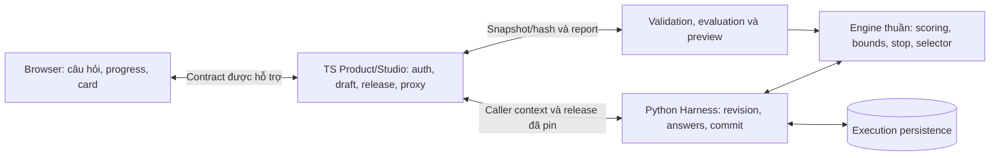

# ADR-002: Đánh giá RIASEC thích ứng và chọn một Hệ chính

| Thuộc tính | Giá trị |
|---|---|
| **Trạng thái** | ACCEPTED (thiết kế). Người dùng duyệt ngày 15/10/2026; chưa triển khai, chưa thẩm định chuyên môn |
| **Thay thế** | PR #13 — G0-04 "Quy tắc phân loại 6 Hệ & cây phân nhánh", commit `501232d` (xem mục 5) |
| **Quyết định liên quan** | DEC-04 (scoring/tie, chốt ở mức thiết kế); tác động DEC-01 (state/edit) và DEC-02 (card/share) |
| **Module** | M-ENG, M-EVL, M-SES, M-CFG, M-UI, M-CRD, M-EXP |
| **Ranh giới nền** | [ADR-001](ADR-001-auth-persistence-release-boundary.md) vẫn PROPOSED; ADR này không duyệt thay auth, TTL, retention hoặc migration |
| **Phạm vi** | Tài liệu architecture; không viết product code, không sửa OpenAPI thực thi, không lập implementation plan |

> **Tóm tắt**
>
> - Ngân hàng **30 items** (5 items × 6 Hệ), rating **1–5**, baseline **12 items** đo đủ sáu Hệ.
> - Điểm mỗi Hệ là **mean** của ratings; Hệ chính là mean cao nhất, so sánh bằng giá trị chính xác.
> - **Dừng sớm** chỉ khi cận dưới của Hệ dẫn đầu lớn hơn cận trên của mọi Hệ khác; không thì hỏi tới tối đa 30.
> - Hòa chính xác ở câu 30 phân xử bằng thứ tự cố định **R/I/A/S/E/C**; không random, không LLM.
> - Python engine là nguồn duy nhất của scoring/selector/stop; card và share vẫn hiển thị **một Hệ**.
> - Thiết kế này **thay thế** cây hai track sáu câu của PR #13; metadata sáu Hệ của PR #13 được giữ lại.

**Mục lục**

- **Phần I — Quyết định:** [1. Bối cảnh](#1-bối-cảnh) · [2. Quyết định](#2-quyết-định) · [3. Phương án](#3-các-phương-án-đã-cân-nhắc) · [4. Hệ quả](#4-hệ-quả-đối-với-architecture-và-contract) · [5. PR #13, G0-04, DEC-04](#5-quan-hệ-với-pr-13-g0-04-và-dec-04) · [6. Bằng chứng](#6-bằng-chứng-và-tiêu-chí-chấp-nhận)
- **Phần II — Đặc tả chi tiết:** [7. Đặc tả](#7-đặc-tả-chi-tiết)
- **Phần III — Ví dụ:** [8. Ví dụ contract và state transitions](#8-ví-dụ-contract-và-state-transitions)
- **Phần IV — Truy vết và theo dõi:** [9. Truy vết](#9-truy-vết-kiến-trúc-yêu-cầu-và-contract) · [10. Câu hỏi mở](#10-câu-hỏi-mở) · [11. Trạng thái](#11-trạng-thái-hiện-tại)

---

# Phần I — Quyết định

## 1. Bối cảnh

Người dùng muốn ưu tiên chất lượng đánh giá, chấp nhận hỏi thêm khi chưa rõ, nhưng kết quả phải có một Hệ chính để tạo card và chia sẻ. Profile sáu câu trong OpenAPI hiện tại không biểu diễn được hành trình biến thiên. Fixture PR #13 chọn track ngay tại Q01 khiến chỉ ba Hệ còn cơ hội nhận điểm.

Đối tượng là học sinh THPT lớp 10–12 (bối cảnh ban đầu của G0-04: Đồng bằng sông Cửu Long). Câu chữ của items và metadata cần được review với nhóm này.

Repository hiện có scaffold và contract; chưa có engine/Harness/chat-card runtime cho profile này. ADR mô tả kiến trúc đích, không xác nhận những thành phần đó đã chạy.

Ngoài phạm vi: triển khai IRT/CAT đã hiệu chỉnh, tự sinh câu bằng LLM, matching trường/ngành mới, đổi auth/TTL/retention, thay template ảnh hay tự publish/activate release. Nội dung câu hỏi thật cần được review riêng trước khi đánh giá người học.

## 2. Quyết định

### 2.1. Đăng ký một profile mới và giữ tương thích

Profile thiết kế là `riasec.mean.bounds.v2`, activity type `personality_assessment_adaptive`, definition schema `2.0`. Ngân hàng có 30 items, năm items cho mỗi Hệ, mỗi item đo một chiều bằng rating nguyên 1..5. Baseline có 12 items: hai items cho mỗi Hệ. Đây là cấu hình pilot kỹ thuật, không phải bộ thang đo đã có bằng chứng chuyên môn.

Đăng ký capability/profile rõ ràng trước khi activation trong tương lai. Không nới schema sáu câu hoặc chuyển activity cũ sang profile mới một cách ngầm định. Profile/schema/engine/definition được ràng buộc với release đã pin; upgrade và rollback không làm đổi rules của activity đang chạy.

### 2.2. Tính điểm trung bình và trả đúng một Hệ

Với mỗi Hệ h, `s_h` là tổng rating và `n_h` là số active answers. Score chính là `s_h/n_h`; so sánh bằng giá trị chính xác, không bằng số hiển thị đã làm tròn. Có thể đổi thang để hiển thị bằng `25*(mean_h-1)`, nhưng không gọi đây là confidence hoặc tỷ lệ dân số.

Hệ có mean cao nhất là Hệ chính. Nếu hòa chính xác thì tiếp tục hỏi trong giới hạn. Đủ 30 answers mà vẫn hòa, phân xử bằng thứ tự R/I/A/S/E/C đã pin trong definition; không cộng điểm ưu tiên và không dùng random hay LLM.

Engine giữ scores, counts, contributions và bằng chứng của cả sáu Hệ. PersonalityCard và ShareCard vẫn trình bày một Hệ chính. Kết quả cùng điểm thấp vẫn tạo một Hệ theo policy nhưng không được diễn giải thành sở thích mạnh hoặc năng lực xuất sắc.

### 2.3. Hỏi thêm và dừng theo cận của ngân hàng cố định

Mean cuối của năm items mỗi Hệ nằm trong khoảng:

```text
lower_h = (s_h + (5 - n_h)) / 5
upper_h = (s_h + 5 * (5 - n_h)) / 5
```

Sau baseline, chỉ dừng sớm khi lower của Hệ đang dẫn đầu lớn hơn upper của mọi Hệ khác. Điều này chứng minh các ratings chưa hỏi trong cùng ngân hàng không thể đổi winner; không chứng minh độ chính xác tâm lý. Nếu không thỏa, hỏi tiếp tới 30 answers. Ở giới hạn, reason `question_limit` được xét trước `bounded_winner`.

Selector cân nhắc cả sáu Hệ: hỏi Hệ dẫn đầu còn item và các Hệ chưa bị loại bằng cận. Ưu tiên khoảng cận rộng nhất; hòa ưu tiên thì dùng thứ tự cố định; item trong Hệ lấy theo item_order. Có fallback tới item chưa hỏi khi cần tiếp tục tới giới hạn. Chi tiết ở mục 7.7; acceptance cases ở mục 7.11.

### 2.4. Python là chủ sở hữu hành vi authoritative



Sơ đồ thể hiện module logic theo ranh giới ADR-001, không yêu cầu thêm service/network hop giữa Harness và engine. Scorer, selector và stop policy không gọi DB/LLM. Preview, evaluation và runtime dùng cùng behavior engine. TS/UI không duy trì một thuật toán tính điểm khác.

### 2.5. State và side effects thuộc Harness

Answer/confirmation hợp lệ tạo prefix mới; Harness tính lại engine rồi commit answers, activity revision, next question hoặc result/card, cùng response idempotency một cách nguyên tử. Đổi đáp án câu k loại suffix sau k, vô hiệu proposal/result/card cũ và recompute từ prefix còn hiệu lực.

GET/reload chỉ đọc state, không tự trả lời câu hoặc đổi release. End/expiry chặn mutation. Lỗi engine hoặc commit không tạo activity completed một phần. Retry cùng key/payload trả outcome đã ghi; conflicts theo revision phải được phản ánh qua contract hiện có.

## 3. Các phương án đã cân nhắc

| Phương án | Đánh đổi |
|---|---|
| Giữ hai track và sáu câu | Ngắn, dễ demo nhưng khóa ba Hệ quá sớm; không đáp ứng ưu tiên hỏi thêm để làm rõ. |
| Bài cố định 30 items | Cân bằng exposure và thích hợp làm baseline pilot; không rút ngắn khi winner đã được chứng minh theo phép tính. |
| **Profile cân bằng + cận điểm xác định** | Chọn; dễ replay và chứng minh winner của ngân hàng, nhưng điều kiện dừng bảo thủ và có thể cần đủ 30 câu. |
| Adaptive theo mô hình đã hiệu chỉnh | Có thể tối ưu thông tin đo; cần ngân hàng và dữ liệu hiệu chỉnh riêng, chưa nằm trong scope. |

## 4. Hệ quả đối với architecture và contract

- Activity mới cần discriminator/capability; các bounds cố định sáu answers, ordinal, progress và completed trong OpenAPI phải có profile tương ứng ở đợt đồng bộ riêng.
- Progress dùng số đã trả lời, min/max và phase; total còn null trước khi hoàn thành, không hứa số câu còn lại cố định.
- Release metadata phải phân biệt schema của envelope delivery với schema của assessment definition và behavior profile.
- Validation/evaluation reports gắn hash/profile/schema/engine và golden outcomes; transport hợp lệ chưa đủ điều kiện publish.
- ShareCard `summary.v1` giữ allowlist và một House; không đưa bảng scores, bounds hay câu trả lời vào ảnh.
- Auth/ownership, TS–Python DB boundary, TTL/retention và template ảnh không được thay đổi bởi ADR này.

Các payload trong [contract boundary](CONTRACT_BOUNDARY_SPEC.md) là ví dụ tài liệu; phần adaptive mới chưa được đăng ký trong OpenAPI/runtime. Không dùng suffix `v2` của một ví dụ scoring cũ để suy luận rằng profile mới đã được hỗ trợ.

## 5. Quan hệ với PR #13, G0-04 và DEC-04

### 5.1. Phần nào của PR #13 được giữ, thay thế hoặc bỏ

| Nội dung PR #13 | Quyết định | Ghi chú |
|---|---|---|
| Sáu House IDs `house_r`..`house_c`, tên Hệ, `mascot_ref`, `theme_ref`, strengths, tendencies, suggested_fields, quote | **Giữ** | Chuyển nguyên vào mục 7.3; vẫn là dữ liệu demo, cần review nội dung |
| Thứ tự lục giác R/I/A/S/E/C | **Giữ**, đổi vai trò | Chỉ dùng làm tie order khi hòa ở giới hạn 30 (7.5) |
| Không random/LLM, kết quả tái lập | **Giữ** | Áp dụng cho scoring, selector, stop và tie |
| DEC-01: sửa câu k thì bỏ downstream, vô hiệu result/card | **Giữ**, mở rộng | Áp dụng cho hành trình độ dài biến thiên (7.8, EX-04) |
| Cây hai track rẽ tại Q01, đúng 6 câu, ngân hàng 11 câu | **Thay thế** | Q01 khóa ba Hệ quá sớm; thay bằng baseline 12 đo cả sáu Hệ (7.4, 7.7) |
| Trọng số chéo 3–2–1, score là tổng, `Contrib(h)` theo % | **Thay thế** | Mean rating 1..5, display_score không phải % (7.5) |
| Tie Stage 3 → Stage 2 → lục giác (fixture thêm `stage1_question_weight`) | **Thay thế** | Fixture và spec G0-04 lệch nhau; thay bằng một tie order duy nhất |
| Templates `intro_prompt`/`completion_message` hứa "6 câu hỏi" | **Thay thế** | Không hứa số câu cố định (7.2) |
| `approval_refs` `appr:g04:namtt:20261013`, `appr:po:huybt:demo` | **Không chuyển** | Ref phê duyệt gắn với definition v1; definition 2.0 cần ref mới (7.2, mục 10) |
| `verify_simulation.mjs` làm bằng chứng | **Bỏ** | `console.assert` không fail process; case "tie" không có hòa; DEC-01 không thực sự được mô phỏng. Thay bằng golden tests của Python engine trong CI (7.11) |

PR #13 không nên merge như deliverable cuối của G0-04. Có thể đóng PR sau khi metadata ở mục 7.3 đã nằm trong ADR này.

### 5.2. DEC-04

ADR-002 chốt nội dung DEC-04 ở mức thiết kế: scoring theo mean, điều kiện dừng theo cận, selector và tie order. Trong OpenAPI, `AssessmentRuleDocument` vẫn mang `x-pending-decision: DEC-04` cho tới khi các rule schemas ở mục 7.2 được đăng ký trong đợt đồng bộ contract. Trước thời điểm đó, definition đúng cấu trúc vẫn **không** publish được.

### 5.3. Việc cần làm lại cho G0-04

1. Soạn ngân hàng 30 items theo 7.4 và được review nội dung.
2. Tạo fixture definition 2.0 theo 7.2, dùng metadata ở 7.3.
3. Viết golden cases bắt buộc theo 7.11 với expected outcomes tính độc lập.
4. Chạy golden cases bằng test của Python engine trong CI; script chỉ dùng tay không được coi là gate.

## 6. Bằng chứng và tiêu chí chấp nhận

Mục 7.11 liệt kê golden cases cho sáu winners, unequal counts, equality of bounds, early stop, final tie, edit, retry, version pinning và share allowlist. Expected outcomes phải độc lập với engine đang được kiểm. Không tuyên bố exhaustive mọi đường trả lời 30 items.

Trong bước soạn thiết kế, đã kiểm công thức mean/bounds/contributions và 11.250 completions của 90 prefix có thể dừng ở ngân hàng thu nhỏ ba Hệ, mỗi Hệ ba items, hai ratings đã quan sát. Kết quả kiểm này hỗ trợ tính chất cận ở mô hình thu nhỏ; không phải runtime test, psychometric validation hoặc bằng chứng pilot đã diễn ra.

Trước khi đánh giá người học thật cần review nội dung/items, dữ liệu pilot, tác động thứ tự và interpretation. So sánh early-stop winner với full-bank winner chỉ kiểm tính chất thuật toán, không thay bằng chứng về chất lượng hướng nghiệp.

---

# Phần II — Đặc tả chi tiết

## 7. Đặc tả chi tiết

Mục này là nguồn chi tiết của các quyết định ở mục 2; định dạng definition ở 7.2–7.4, thuật toán ở 7.5–7.7, vòng đời và contract ở 7.8–7.9, kiểm chứng ở 7.10–7.12. Đây là cấu hình pilot kỹ thuật đã được duyệt về thiết kế (ngân hàng 30 items, baseline 12, thang 1–5, điểm trung bình, dừng bằng cận điểm, thứ tự hòa RIASEC), không phải thông số đã được chuyên môn thẩm định.

### 7.1. Căn cứ và giới hạn của phiên bản hiện tại

- [Thiết kế hội thoại/card local](../superpowers/specs/2026-10-09-conversation-assessment-card-design.md).
- [ADR-001](ADR-001-auth-persistence-release-boundary.md) và [contract boundary](CONTRACT_BOUNDARY_SPEC.md), hiện có ở HEAD `fdb15d9`.
- [Experience OpenAPI](../openapi/experience-api.yaml), [Activity schemas](../openapi/schemas/activity.yaml), [typed blocks](../openapi/schemas/typed-blocks.yaml), [ShareCard](../openapi/result-api.yaml).
- [SRS local](../srs/conversation-assessment-card/main.tex) và [tracker local](../implementation/conversation-assessment-card-tracker.md): đang untracked lúc viết; dùng làm context, không coi là contract đã được merge/phê duyệt.
- PR #13, commit `501232d` (cũng là HEAD của PR): spec G0-04, `demo_experience_definition.json`, `verify_simulation.mjs`. Ba file chưa có trên main; phần nào được giữ hoặc thay thế xem mục 5.

Profile hiện tại ràng buộc đúng sáu answers, progress total=6, ordinal tối đa 6 và completed có đúng sáu answers. Fixture PR #13 rẽ track tại Q01, rồi cộng điểm trong ba Hệ của track; tổng điểm luôn 19. Bản mới là thay đổi hành vi và contract, không chỉ sửa trọng số fixture cũ.

### 7.2. Cấu trúc definition 2.0

Definition 2.0 giữ khung `ExperienceDefinitionDocument` hiện có (`schema_version`, `definition_id`, `definition_version`, `engine_version`, `is_demo`, `questions`, `houses`, bốn rule documents, `templates`, `evaluation_cases`, `approval_refs`) với các khác biệt sau:

| Thành phần | Definition 1.0 (PR #13) | Definition 2.0 (đề xuất) |
|---|---|---|
| `schema_version` | `"1.0"` | `"2.0"` |
| `questions[]` | `question_id`, `prompt`, `choices` | Thêm `house_id`, `item_order` (1..5); đúng năm `choices`, mỗi option thêm `rating` 1..5 |
| `selection_rules` | `rule.schema.localis.selection:v1` — `initial_question_id`, `branches` | `rule.schema.localis.selection.adaptive_bounds:v1` — `baseline_order` (12 question IDs), `selector: widest_bound_gap`, `fallback: tie_order_then_item_order` |
| `scoring_rules` | `rule.schema.localis.scoring:v1` — `weights` theo option | `rule.schema.localis.scoring.mean_rating:v1` — `rating_scale: [1, 5]`; rating đọc từ option, không có cross-weight |
| `coverage_rules` | `required_question_count = max_question_count = 6` | `rule.schema.localis.coverage.bounded_stop:v1` — `items_per_house: 5`, `baseline_total: 12`, `min_answers_per_house: 2`, `max_total: 30`, `stop: strict_bounds` |
| `tie_policy` | `priority_sequence` nhiều tầng + `hexagonal_order` | `rule.schema.localis.tie.fixed_order:v1` — `order: [house_r, house_i, house_a, house_s, house_e, house_c]`, `apply_at: question_limit` |
| `templates` | Ba keys, nội dung hứa "6 câu hỏi" | Cùng ba keys; nội dung không hứa số câu cố định |
| `evaluation_cases[]` | Đúng 6 answers; expected `question_ids`, `house_id`, `scores` | 12..30 answers; expected thêm `stopping_reason`, `tie_applied`, và means dạng tử/mẫu |
| `approval_refs` | Ref của G0-04 và PO demo | Ref mới cho definition 2.0; ref cũ không được kế thừa |

Tên các rule schemas là **đề xuất**; tên cuối cùng chốt khi đồng bộ OpenAPI và đăng ký engine. Engine từ chối payload có rule schema chưa đăng ký.

Ví dụ templates không hứa số câu:

```json
{
  "intro_prompt": "Chào bạn, mình sẽ hỏi một số câu về những hoạt động bạn thích để tìm Hệ phù hợp nhất với bạn nhé!",
  "clarification_prompt": "Bạn chọn mức độ gần nhất với cảm nhận của mình nhé:",
  "completion_message": "Xong rồi! Thẻ Hệ của bạn đang được tạo."
}
```

### 7.3. Metadata sáu Hệ

Lấy nguyên từ fixture PR #13. Đây là dữ liệu demo cho PersonalityCard/ShareCard, chưa được chuyên môn duyệt. `strengths` mô tả Hệ, không phải đánh giá năng lực của người học (xem 7.12).

| `house_id` | Tên hiển thị | `mascot_ref` | `theme_ref` | Quote |
|---|---|---|---|---|
| `house_r` | Hệ Khám Phá (Realistic) | `mascot_phoenix_maker` | `theme_realistic_crimson` | Hành động thực tế biến bản thiết kế thành thế giới hữu hình. |
| `house_i` | Hệ Tư Duy (Investigative) | `mascot_owl_sage` | `theme_investigative_sapphire` | Tri thức là chiếc chìa khóa giải mã mọi quy luật của tự nhiên. |
| `house_a` | Hệ Sáng Tạo (Artistic) | `mascot_chameleon_artist` | `theme_artistic_amber` | Sự khác biệt và cảm xúc chính là nguồn cội của nghệ thuật. |
| `house_s` | Hệ Gắn Kết (Social) | `mascot_dolphin_healer` | `theme_social_emerald` | Thấu hiểu và sẻ chia mang lại sự thay đổi bền vững cho con người. |
| `house_e` | Hệ Tiên Phong (Enterprising) | `mascot_lion_leader` | `theme_enterprising_ruby` | Dẫn dắt bằng tầm nhìn, bứt phá bằng hành động quyết liệt. |
| `house_c` | Hệ Chu Toàn (Conventional) | `mascot_beaver_curator` | `theme_conventional_amethyst` | Sự chuẩn xác và quy củ là nền móng cho mọi tổ chức vững mạnh. |

<details>
<summary>Strengths, tendencies và suggested_fields của từng Hệ</summary>

**`house_r` — Hệ Khám Phá**

- Strengths: Kỹ năng thực hành xuất sắc; Tư duy không gian và cơ khí; Thích ứng cao với công cụ thực tế.
- Tendencies: Thích làm việc với máy móc, công cụ hoặc hoạt động ngoài trời; Hành động thực chiến hơn là lý thuyết suông; Giải quyết vấn đề bằng kết quả trực quan hữu hình.
- Suggested fields: Kỹ thuật Cơ điện tử & Robot; Kỹ thuật Xây dựng & Giao thông; Nông nghiệp Công nghệ cao; Kỹ thuật Ô tô.

**`house_i` — Hệ Tư Duy**

- Strengths: Tư duy phân tích và logic sắc bén; Khả năng nghiên cứu chuyên sâu; Hiểu biết dữ liệu và mô hình hóa toán học.
- Tendencies: Thích tìm hiểu nguyên lý sâu xa của sự vật hiện tượng; Đam mê giải mã bài toán dữ liệu phức tạp; Ưa thích môi trường nghiên cứu độc lập và học thuật.
- Suggested fields: Khoa học Dữ liệu & Trí tuệ Nhân tạo; Công nghệ Thông tin & Khoa học Máy tính; Công nghệ Sinh học & Hóa sinh; Kinh tế học & Nghiên cứu Tài chính.

**`house_a` — Hệ Sáng Tạo**

- Strengths: Trực giác thẩm mỹ vượt trội; Tư duy phi tuyến tính và đổi mới sáng tạo; Khả năng truyền tải thông điệp bằng nghệ thuật và hình ảnh.
- Tendencies: Yêu thích tự do sáng tạo, không gò bó khuôn khổ cứng nhắc; Nhạy cảm với cảm xúc, câu chuyện và vẻ đẹp; Thể hiện bản thân qua tác phẩm thiết kế, nghệ thuật hoặc truyền thông.
- Suggested fields: Thiết kế Đồ họa & Đa phương tiện; Truyền thông & Báo chí Hiện đại; Thiết kế Game & Kỹ xảo Hoạt hình; Kiến trúc & Thiết kế Nội thất.

**`house_s` — Hệ Gắn Kết**

- Strengths: Khả năng lắng nghe thấu cảm; Kỹ năng sư phạm và truyền đạt kiến thức; Năng lực gắn kết và xây dựng cộng đồng.
- Tendencies: Thích chăm sóc, hỗ trợ và phát triển tiềm năng của người khác; Ưa thích làm việc nhóm trong môi trường tương tác thân thiện; Quan tâm sâu sắc đến giá trị con người và tác động xã hội.
- Suggested fields: Sư phạm & Giáo dục Đổi mới; Tâm lý học & Công tác Xã hội; Y đa khoa & Điều dưỡng Chăm sóc sức khỏe; Quản trị Nhân sự & Trải nghiệm Con người.

**`house_e` — Hệ Tiên Phong**

- Strengths: Kỹ năng lãnh đạo và truyền cảm hứng; Tư duy chiến lược kinh doanh; Dám chấp nhận thử thách và quản trị rủi ro.
- Tendencies: Thích khởi xướng, điều phối và thúc đẩy đội ngũ đạt mục tiêu; Tham vọng đạt được thành quả kinh tế và khẳng định vị thế; Tự tin trong đàm phán, thuyết phục và mở rộng mạng lưới quan hệ.
- Suggested fields: Quản trị Kinh doanh & Khởi nghiệp; Marketing & Phát triển Thị trường; Thương mại Quốc tế & Logistics; Tài chính Doanh nghiệp & Đầu tư.

**`house_c` — Hệ Chu Toàn**

- Strengths: Tính cẩn trọng và chuẩn xác đến từng chi tiết; Năng lực thiết lập quy trình chuẩn mực; Quản lý dữ liệu và kiểm soát tuân thủ xuất sắc.
- Tendencies: Thích công việc rõ ràng, ngăn nắp và có cấu trúc trật tự; Đáng tin cậy trong việc duy trì vận hành hệ thống ổn định; Xem trọng tính chính xác, quy chuẩn và số liệu thực tế.
- Suggested fields: Kế toán & Kiểm toán Chuyên nghiệp; Phân tích Nghiệp vụ Kinh doanh (BA); Quản trị Hệ thống Thông tin & An toàn Vận hành; Luật Doanh nghiệp & Quản lý Hành chính.

</details>

### 7.4. Ngân hàng câu và đáp án

Profile đề xuất: `riasec.mean.bounds.v2`. Activity type đề xuất: `personality_assessment_adaptive`; definition schema đề xuất `2.0`. Các tên này phải được đăng ký capability/schema trong implementation, không tự được hỗ trợ vì có mặt trong tài liệu.

Ngân hàng có đúng 30 items: năm items cho mỗi Hệ R/I/A/S/E/C. Mỗi item có `question_id`, `house_id`, `item_order` 1..5 trong Hệ, prompt và năm options. Option ID ánh xạ duy nhất tới rating nguyên 1..5. Item chỉ đo một chiều chính; profile này không dùng cross-weight 3–2–1 hoặc trọng số tùy ý.

Thang trả lời: 1 rất không thích, 2 không thích, 3 trung lập, 4 thích, 5 rất thích. Nội dung hỏi về sở thích thực hiện một hoạt động cụ thể, không trộn điểm năng lực tự nhận vào cùng score. Các items trong mỗi Hệ cần khác bối cảnh và được review nội dung.

Một item là một lượt đánh giá; không gộp nhiều ratings vào một màn hình rồi gọi là một câu để giữ giới hạn sáu câu cũ.

Baseline 12 items dùng hai items đầu của mỗi Hệ, theo thứ tự R1, I1, A1, S1, E1, C1, R2, I2, A2, S2, E2, C2. Đây là thứ tự demo cố định, cần kiểm tác động thứ tự trong pilot. Không loại Hệ nào dựa vào câu đầu.

Text chưa rõ hoặc người học chưa biết cách trả lời đi qua clarification, không tự map thành rating 3 và không tăng count. Baseline này chỉ nhận năm ratings được xác nhận; người học có thể kết thúc activity theo lifecycle hiện có. End trước khi có kết quả hợp lệ không tạo card. Hỗ trợ skip có commit là profile khác, không nằm trong bản này.

### 7.5. Scoring và chọn Hệ chính

Với mỗi Hệ h, giữ tổng rating `s_h` và số active answers `n_h`. Khi n_h>0:

```text
mean_h = s_h / n_h
display_score_h = 100 * (mean_h - 1) / 4
```

`display_score` là đổi thang tuyến tính sang 0..100, không phải phần trăm đóng góp, percentile hoặc xác suất đúng. Sáu scores không cần cộng thành 100. Không chia score cho tổng score của sáu Hệ.

Chọn Hệ có mean cao nhất. So sánh chính xác bằng tích chéo `s_a*n_b` và `s_b*n_a`, không dùng số đã làm tròn cho classification hoặc tie. `n_h=0` là thiếu dữ liệu, không phải score 0; không tạo kết quả trước baseline đủ coverage.

Đóng góp của mỗi answer vào mean là `rating/n_h`; đóng góp vào display_score là `25*(rating-1)/n_h`, dùng n_h của snapshot cuối đang được tính. Tổng contributions của một Hệ phải khớp score tương ứng. Sau thêm/edit answer phải tính lại contributions vì mẫu số có thể thay đổi.

Ví dụ: R có ratings [4,4] và I có [5,4,3,4] đều mean=4. I không tự thắng chỉ vì được hỏi nhiều hơn. Mean giải quyết chênh lệch số items nhưng không chứng minh items tương đương về đo lường; chất lượng đó cần dữ liệu pilot.

Tie order đề xuất là `[R,I,A,S,E,C]`, một permutation đủ sáu Hệ được lưu trong definition. Thứ tự chỉ phân xử hòa chính xác khi đến giới hạn 30 answers; không cộng thêm điểm ưu tiên cho bất kỳ Hệ nào.

### 7.6. Điều kiện dừng có thể chứng minh

Không đặt ngưỡng confidence bằng tay. Thay vào đó, tính cận của mean cuối cùng nếu làm đủ năm items của từng Hệ. Với ratings còn lại luôn trong [1,5]:

```text
lower_h = (s_h + 1 * (5 - n_h)) / 5
upper_h = (s_h + 5 * (5 - n_h)) / 5
```

Cận áp dụng cho chính ngân hàng 30 items đã pin; không phải khoảng tin cậy thống kê hay mức sở thích thật. `n_h=5` cho lower=upper=mean. Cận không cần giả định các câu chưa hỏi có xác suất đáp án nào.

Sau baseline, gọi w là Hệ dẫn đầu theo mean, dùng tie order tạm thời để chọn w khi cần selector. Dừng sớm với reason `bounded_winner` chỉ nếu:

```text
mọi n_h >= 2
và lower_w > max(upper_h cho h != w)
```

Khi điều kiện đúng, không cách gán rating 1..5 nào cho các items chưa hỏi có thể làm Hệ khác thắng hoặc hòa w ở bài đủ ngân hàng. Cùng lúc w cũng đang có mean quan sát cao nhất. Điều này bảo đảm winner theo phép tính của ngân hàng, không chứng minh độ chính xác hướng nghiệp.

Ví dụ độc lập: w đã có ba ratings đều 5, các Hệ còn lại mỗi Hệ có ba ratings đều 1. `lower_w=3.4`, mọi `upper_h=2.6`; có thể dừng ở 18 answers. Nếu w mới có hai ratings 5 và các Hệ khác có hai ratings 1 thì `lower_w=2.6`, `upper_h=3.4`; phải hỏi tiếp.

Không dùng `>=` cho dừng sớm: bằng cận còn cho phép hòa. Nếu chưa chứng minh được winner thì hỏi tới tối đa 30 answers. Đủ 30 và coverage hợp lệ: chọn mean lớn nhất, dùng tie order nếu hòa, reason `question_limit`.

Thứ tự đánh giá: validate prefix/coverage; nếu đã đủ 30 thì xử lý question_limit trước; nếu chưa đủ 30 thì xét bounded_winner; còn lại continue. Reason không thay đổi tùy theo thứ tự kiểm tra ngầm của implementation.

Không dừng vì người học trả lời không nhất quán hoặc thứ hạng tạm thời ổn định; có thể lưu các thông tin đó để phân tích pilot. Thiết kế này chủ động dùng điều kiện bảo thủ, có thể phải hỏi đủ 30 câu ở nhiều hồ sơ.

### 7.7. Adaptive selector

Selector là hàm thuần của definition và ordered active answers. Trước khi scoring/selection, kiểm rằng prefix answers là đường hợp lệ đã được selector phát ra; option thuộc question và không có item lặp.

Sau khi baseline xong và stop policy yêu cầu tiếp tục:

1. Tính mean, lower, upper; chọn w theo mean và tie order tạm thời.
2. Tập Hệ cần hỏi gồm w nếu còn item, cùng mọi Hệ h khác còn item và `upper_h >= lower_w`. Các Hệ này chưa được loại khỏi khả năng tranh winner bằng cận.
3. Chọn Hệ có khoảng `upper_h-lower_h` lớn nhất; nếu bằng nhau, chọn theo tie order. Điều này ưu tiên giảm phần chưa được quan sát nhiều nhất trong nhóm còn tranh kết quả.
4. Trong Hệ đã chọn, lấy item chưa hỏi có `item_order` nhỏ nhất.
5. Nếu tập ở bước 2 rỗng nhưng chưa đủ 30 và chưa thể dừng sớm, lấy item chưa hỏi theo `(house tie order, item_order)`. Trường hợp các Hệ cao nhất đã dùng hết items và hòa vẫn tiếp tục tới global limit trước khi phân xử.

Không chỉ khóa vào hai Hệ đầu; cả sáu Hệ có thể trở lại nhóm cần hỏi theo cận sau mỗi answer. Không gọi LLM hoặc random để lựa chọn.

Hết ngân hàng khi chưa đủ giới hạn và chưa có valid stop, prefix sai, mapping thiếu hoặc version không hỗ trợ trả typed failure; không tạo card giả hay tự sinh câu. ID lỗi cụ thể được bổ sung theo convention error codes ở bước contract, không tự coi các tên trong spec là code đã đăng ký.

### 7.8. Ranh giới engine và vòng đời

| Module logic | Input | Output | Dependency |
|---|---|---|---|
| Validator | Definition/profile/capability | Field/rule errors hoặc valid snapshot | Registered schema và giới hạn profile |
| Scorer | Definition + valid active answers | Sums, counts, exact means, bounds, contributions | Mapping rating đã pin |
| Stop policy | Scoring snapshot + budget | Continue hoặc reason/winner | Policy đã pin |
| Selector | Definition + valid prefix + stop decision | Next question ID/rule reason | Ngân hàng và ordering đã pin |
| Projector | Valid result + metadata | PersonalityCard/ShareCard | Metadata/template đã pin |

Preview, evaluation và runtime dùng cùng engine Python. TS không viết bản scoring khác; UI render state server. Ranh giới nội bộ ở bảng trên không yêu cầu tạo service/network hop riêng.

Sau một answer/confirmation hợp lệ: thêm answer vào prefix, tính lại scorer, đánh giá stop, rồi chọn next question hoặc tạo result/card. Harness commit answer, activity revision, state, result validity, response idempotency nguyên tử. Conflicts/retries giữ hành vi của contract session hiện có.

Edit câu k: thay đáp án k, bỏ suffix sau k, vô hiệu pending proposal và result/card cũ; recompute từ prefix mới, không cộng chênh lệch vào cache cũ. Nếu prefix mới đã đạt valid stop thì tạo result revision mới và completed; nếu chưa thì in_progress và next question mới. Completed cho phép edit khi activity chưa end/expiry. Chỉ commit accepted answers tăng completed count.

Result lưu release ID/content hash, definition/schema/engine/profile refs, active answer IDs/option IDs và rating contributions, sums/counts/means/bounds, primary_house_id, stopping_reason, tie_applied và tie policy ref. Means giữ tử/mẫu để replay; số làm tròn chỉ dùng trình bày. GET latest valid và export phải kiểm validity/result revision như hiện có.

Card/share vẫn có một House. ShareCard `summary.v1` chỉ dùng allowlist hiện có: display_name, house, branding, demo marker và các refs phục vụ lifecycle/template. Không thêm bảng sáu scores, bounds, confidence hoặc lịch sử answers vào ảnh chia sẻ. Technical refs không được render.

### 7.9. Thay đổi contract và tương thích

Đăng ký profile mới bằng discriminator/capability rõ ràng; không nới constraints của profile sáu câu rồi tự diễn giải nó thành adaptive. Product API/client phải nhận biết profile mới trước khi activation. Unsupported client/profile trả lỗi có kiểu.

Capability được khai báo tại conversation/preview bootstrap, lưu cùng state và dùng cho mọi start qua unified turns/Agent. Profile adaptive yêu cầu Activity view version 2; hai block chứa progress là assessment_question và assessment_clarification cũng dùng version 2. Text/personality_card giữ version 1; choices nằm trong question. Khai báo profile không ghi đè danh sách supported_blocks. Quy tắc defaults, kiểm manifest và pin capability nằm ở [contract boundary, mục 4.1](CONTRACT_BOUNDARY_SPEC.md#41-nhận-diện-profile-và-compatibility).

Progress đề xuất cho profile mới:

```json
{
  "completed": 14,
  "min_total": 12,
  "max_total": 30,
  "total": null,
  "phase": "adaptive"
}
```

`completed` là số active scored answers; `phase` là baseline/adaptive/completed. Trước khi hoàn thành `total=null`, kể cả lúc baseline; không dùng max_total làm mẫu số tiến độ chắc chắn. Khi completed, total bằng completed thực tế và phase=completed. UI dùng “Đã trả lời 14 câu; đang làm rõ kết quả”, không hứa còn đúng 16 câu. End/expiry giữ số đã trả lời và phase thu thập gần nhất; status đóng vẫn do ActivityView quản lý, total không đổi thành completed nếu chưa có result.

| Contract | Thay đổi cần thiết ở implementation |
|---|---|
| experience-api.yaml | Definition/profile mới, item house/order/rating mapping, golden case answers và expected question_ids có độ dài biến thiên |
| schemas/activity.yaml | Activity type/profile dispatch; ordinal/answers/progress/state constraints riêng, completed dựa valid stop thay cho đúng 6 |
| schemas/typed-blocks.yaml | Negotiation block/state schema và progress adaptive; card vẫn một House |
| conversation/activity entrypoints và preview | Nhận diện type/capability mới; giữ action/key/revision và không chuyển profile ngầm |
| result-api.yaml | Giữ projection summary.v1 nếu payload vẫn đúng allowlist; dữ liệu nội bộ result mở rộng theo engine mới |
| validation/evaluation/release APIs | Report ràng buộc profile/schema/engine/hash; publish gate kiểm cả supported profile và golden outcomes |

SRS cần revision mới cho FR-SES-03/06/07, FR-ENG-01..05, FR-CFG-01/03/04 và AT-01/03/07/10/12/13/20 cùng các ví dụ/progress cố định sáu câu. Tracker A-01/02/04, B-02/03/04, C-01..05, D-01/02/05 cần phản ánh scope đó. Spec này chỉ ghi tác động, không sửa hoặc đánh dấu Done các tài liệu local của người dùng.

Release cũ tiếp tục dùng profile/schema cũ. Activity đang chạy không tự upgrade; phiên mới chỉ dùng release mới sau validation, evaluation và activation được phép. Rollback đổi pointer cho phiên mới; historical result/card được đọc bằng snapshot đúng version. Không chuyển mean v2 thành score 19 điểm v1 hoặc so trực tiếp hai thang.

### 7.10. Validator và giới hạn kiểm chứng

Validator kiểm đúng sáu House IDs duy nhất; đúng năm items mỗi Hệ; item_order 1..5 không trùng; IDs/options không trùng; mỗi item có năm ratings 1..5; đủ metadata/projector refs; tie order là permutation; baseline=12 và budget=30 của profile này; version hỗ trợ.

Số đường trả lời 30 items là quá lớn để exhaust toàn cây. Không tuyên bố exhaustive validation mọi rating path. Dùng invariants của profile: finite bank, item không lặp, count tăng đúng một, mỗi Hệ tối đa năm, baseline bảo đảm coverage, và fallback làm mọi path kết thúc không quá 30 answers. Cận được chứng minh từ rating range và được kiểm bằng exhaustive completion trên ngân hàng thu nhỏ trong tests.

Validation semantic không thay thế chuyên môn duyệt prompt, thang đo và interpretation. Profile chỉ cho phép ngân hàng đáp ứng cấu trúc trên; mở rộng bank size/weights/skip cần behavior version khác và bộ checks tương ứng.

### 7.11. Acceptance cases và golden tests

| Case | Expected behavior |
|---|---|
| Sáu winners | Mandatory golden case độc lập cho từng R/I/A/S/E/C; exact scores và primary đúng |
| Unequal counts | R=[4,4], I=[5,4,3,4] có cùng mean; không dùng sum làm winner |
| Bounds ở baseline | Hệ nổi bật hai ratings 5, các Hệ khác hai ratings 1: tiếp tục, không early stop |
| Early stop ở 18 | Ba ratings 5 cho R, ba ratings 1 cho từng Hệ khác: baseline/adaptive selector replay hợp lệ, dừng ở 18 với bounded_winner |
| Equality of bounds | lower_w bằng upper đối thủ: tiếp tục |
| Final tie | 30 ratings đều 3: scores bằng nhau, primary=R theo policy, tie_applied=true, question_limit |
| Tất cả đều thấp | 30 ratings đều 1: vẫn một House bằng tie policy, không diễn giải primary thành sở thích mạnh |
| Rounded collision | Hai means khác nhau nhưng display làm tròn giống nhau: so exact mean, không tie giả |
| Challenger trở lại | Prefix changes tạo một Hệ thứ ba đủ điều kiện tranh winner; selector không giữ danh sách top-two cố định |
| Prefix/member sai | Câu sai đường, option sai item, duplicate item hoặc mapping thiếu: typed failure, không commit |
| Thiếu coverage | Dưới baseline hoặc một Hệ thiếu ratings: không completed/card |
| Edit/retry/conflict | Cắt suffix, recompute stop và revision; duplicate/stale không tạo thêm mutation |
| Version/pinning | Đổi active release không đổi tiếp tục/scoring của activity cũ; unsupported version fail |
| LLM tắt/lỗi | Option flow vẫn hoàn thành; text chưa confirmed không score |
| Export | Chỉ một House và allowlist; invalidated/stale result không download như latest valid |

Expected outcomes phải được tính độc lập, không generate từ engine đang kiểm. Checks bắt buộc fail phải trả exit code khác 0; không dùng console.assert như gate. Fixture chung qua TS/Python/client kiểm transport; behavior evaluation dùng engine Python duy nhất.

Golden cases chạy như test của Python engine (pytest) trong CI, đọc cùng fixture definition 2.0. So sánh scores phải strict: key thừa, thiếu hoặc sai tên House đều là fail. Script chạy tay như `verify_simulation.mjs` của PR #13 không được dùng làm gate.

### 7.12. Đánh giá pilot

Pilot kiểm người học hiểu đúng prompts, độ ổn định khi trả lời lại, tác động thứ tự, chất lượng các items và cách diễn giải một House khi nhiều chiều tương đương. Thu đủ 30 ratings ở baseline pilot để đối chiếu early-stop winner với full-bank winner và báo số câu cần hỏi, tỷ lệ dừng sớm, tỷ lệ tie và các lỗi kỹ thuật. Full-bank agreement chỉ kiểm tính chất thuật toán, không được gọi là validity hướng nghiệp.

Mean/bounds là heuristic minh bạch cho một finite bank; chưa điều chỉnh item difficulty, response bias hay khác biệt văn hóa. Không dùng thiết kế demo này để tự xác nhận strengths/năng lực hoặc confidence tâm lý. Nội dung và mức đủ tốt để áp dụng cần bằng chứng/chuyên môn riêng.

---

# Phần III — Ví dụ

## 8. Ví dụ contract và state transitions

Phạm vi: **ví dụ tài liệu kiến trúc**, chưa có API/runtime/fixtures thực thi cho profile mới. Các JSON là input mẫu hoặc fragments theo contract đích; không coi fragments là response/definition đầy đủ hoặc schema đã được OpenAPI hiện tại chấp nhận. Mỗi scenario đối chiếu được với ma trận truy vết ở mục 9; đây là đầu vào review docs, chưa phải kết quả E2E, runtime implementation hay pilot trên người học.

### 8.1. Quy ước của các ví dụ

- Profile: `riasec.mean.bounds.v2`; activity type: `personality_assessment_adaptive`.
- Ký hiệu R/I/A/S/E/C tương ứng metadata IDs minh họa `house_r`, `house_i`, `house_a`, `house_s`, `house_e`, `house_c`. Cùng mapping được pin trong definition của ví dụ; UI không tự đổi IDs.
- Items trong ngân hàng mẫu đặt ID `q_r_01`..`q_r_05`, tương tự cho năm Hệ còn lại. Mỗi item có năm option IDs ánh xạ rating 1..5; ví dụ `opt_r_03_1` là rating 1 của `q_r_03`.
- Prompt, theme, mascot và branding ở đây chỉ là dữ liệu demo; không xác nhận đã có assets hoặc được chuyên môn duyệt.
- `expected_revision` thuộc conversation; `expected_activity_revision` thuộc activity. Các số revisions minh họa có thể lớn hơn số scored answers vì name/clarification/chat cũng có thể đổi state.
- Kết quả nội bộ của Python được tách khỏi public Activity/card/share; không proxy các scoring fragments dưới đây ra browser.

### 8.2. EX-01 — Bootstrap capability rồi bắt đầu qua chat

#### 8.2.1. Khai báo tại `POST /conversations`

```json
{
  "schema_version": 1,
  "idempotency_key": "idem_demo_create_01",
  "accepted_activity_profiles": ["riasec.mean.bounds.v2"],
  "supported_blocks": [
    {"type": "text", "schema_versions": [1]},
    {"type": "assessment_question", "schema_versions": [2]},
    {"type": "assessment_clarification", "schema_versions": [2]},
    {"type": "personality_card", "schema_versions": [1]}
  ]
}
```

`schema_version=1` ở input conversation không đồng nghĩa Activity/blocks cũng phải version 1. `accepted_activity_profiles` là trường mới dự kiến, chưa có trong CreateConversationInput hiện tại. Python lưu capability snapshot sau khi kiểm manifest; TS không tự thêm block versions hoặc quyền auth.

#### 8.2.2. Message có thể kích hoạt assessment qua unified turns

Ví dụ request shape theo MessageTurnInput, với revision 0 từ bootstrap của conversation này:

```json
{
  "schema_version": 1,
  "type": "message",
  "expected_revision": 0,
  "idempotency_key": "idem_demo_start_01",
  "content": {"text": "Em muốn khám phá sở thích nghề nghiệp."}
}
```

Agent có thể nhận diện intent, nhưng Harness phải kiểm capability đã lưu, release/profile được hỗ trợ và owner/lifecycle trước khi tạo activity. Message không cho phép LLM đổi profile hoặc bổ sung capability. Sau tên hợp lệ, bắt đầu item R1; chưa có scored answer thì progress.completed=0 và total=null.

#### 8.2.3. Các trường hợp incompatibility

| Điều kiện | Expected outcome |
|---|---|
| Khai báo adaptive nhưng chỉ hỗ trợ question/clarification v1 | Bootstrap bị từ chối trước khi tạo conversation; không tự thêm v2 |
| Không có accepted_activity_profiles, không có supported_blocks | Defaults legacy; chat v1 có thể hoạt động, start adaptive phải bị chặn trước commit |
| Agent yêu cầu adaptive trong conversation legacy | Không tạo activity rồi mới phát hiện UI không đọc được progress |
| Admin preview thiếu capability adaptive | Cùng checks ở preview bootstrap; quyền Admin không bỏ qua manifest |

Không đặt error ID mới trong ví dụ này: tên/mã/status phải theo contract lỗi được đồng bộ ở đợt riêng. Chưa có endpoint tạo Activity độc lập được giả định.

### 8.3. EX-02 — Từ baseline 12 tới kết quả ở 18 answers

#### 8.3.1. Bằng chứng trả lời và selector

Giả sử mọi item R được chọn rating 5 và mọi item của I/A/S/E/C được chọn rating 1. Baseline theo đúng thứ tự R1,I1,A1,S1,E1,C1,R2,I2,A2,S2,E2,C2.

| Completed | Counts và sums quan sát | Cận quan trọng | Quyết định |
|---|---|---|---|
| 12 | R: n=2,s=10; mỗi Hệ khác: n=2,s=2 | lower_R=2.6; upper đối thủ=3.4 | Tiếp tục, chọn R3 |
| 13 | R: n=3,s=15; mỗi Hệ khác còn n=2,s=2 | lower_R=3.4; upper đối thủ=3.4 | Bằng cận chưa đủ dừng; chọn I3 |
| 14 | R và I có n=3; A/S/E/C có n=2 | Các Hệ chưa có item 3 vẫn upper=3.4 | Tiếp tục, chọn A3 |
| 15..17 | Lần lượt nhận A3,S3,E3 | Vẫn còn ít nhất một đối thủ upper=3.4 | Chọn tiếp S3,E3,C3 theo thứ tự |
| 18 | R: n=3,s=15; mỗi Hệ khác: n=3,s=3 | lower_R=3.4 > max upper khác=2.6 | Dừng, bounded_winner, House R |

Điều kiện strict `>` giữ ví dụ ở 13 answers tiếp tục. Cả sáu Hệ đã được đo; không loại A/S/E/C ở câu đầu.

#### 8.3.2. Fragment public state ở 14 answers

```json
{
  "id": "act_demo_adaptive_01",
  "schema_version": 2,
  "activity_type": "personality_assessment_adaptive",
  "algorithm_profile": "riasec.mean.bounds.v2",
  "revision": 16,
  "status": "in_progress",
  "progress": {
    "completed": 14,
    "min_total": 12,
    "max_total": 30,
    "total": null,
    "phase": "adaptive"
  },
  "current_question": {"question_id": "q_a_03"},
  "result": null
}
```

`current_question` ở đây chỉ minh họa ID, không thay response question đầy đủ gồm prompt/options. Browser hiển thị “Đã trả lời 14 câu; đang làm rõ kết quả”. Không tính điểm hoặc tự chuyển completed.

Request trả lời câu tiếp theo qua `POST /conversations/{id}/turns`, giả sử conversation revision hiện tại là 20:

```json
{
  "schema_version": 1,
  "type": "interaction",
  "action": "submit_answer",
  "activity_id": "act_demo_adaptive_01",
  "expected_revision": 20,
  "expected_activity_revision": 16,
  "idempotency_key": "idem_demo_answer_15",
  "payload": {"question_id": "q_a_03", "option_id": "opt_a_03_1"}
}
```

Commit thành công tạo completed count 15, conversation revision 21 và activity revision 17. Retry cùng key/payload trả outcome đó, không tăng completed lên 16. Chat tự do giữa hai answers chỉ đổi conversation revision; client phải dùng revision conversation mới, không đồng nhất hai guard.

#### 8.3.3. Fragment kết quả nội bộ tại 18 answers

```json
{
  "primary_house_id": "house_r",
  "stopping_reason": "bounded_winner",
  "tie_applied": false,
  "statistics": {
    "house_r": {"sum": 15, "count": 3, "mean": {"numerator": 15, "denominator": 3}, "lower": {"numerator": 17, "denominator": 5}, "upper": {"numerator": 25, "denominator": 5}},
    "house_i": {"sum": 3, "count": 3, "mean": {"numerator": 3, "denominator": 3}, "lower": {"numerator": 5, "denominator": 5}, "upper": {"numerator": 13, "denominator": 5}},
    "house_a": {"sum": 3, "count": 3, "mean": {"numerator": 3, "denominator": 3}, "lower": {"numerator": 5, "denominator": 5}, "upper": {"numerator": 13, "denominator": 5}},
    "house_s": {"sum": 3, "count": 3, "mean": {"numerator": 3, "denominator": 3}, "lower": {"numerator": 5, "denominator": 5}, "upper": {"numerator": 13, "denominator": 5}},
    "house_e": {"sum": 3, "count": 3, "mean": {"numerator": 3, "denominator": 3}, "lower": {"numerator": 5, "denominator": 5}, "upper": {"numerator": 13, "denominator": 5}},
    "house_c": {"sum": 3, "count": 3, "mean": {"numerator": 3, "denominator": 3}, "lower": {"numerator": 5, "denominator": 5}, "upper": {"numerator": 13, "denominator": 5}}
  }
}
```

Đây là cấu trúc lưu bằng chứng minh họa phía Python, không phải public Result API. Snapshot hoàn chỉnh còn phải có release/hash/schema/engine/policy refs, answer IDs/option IDs và contributions theo mục 7.8. Tử/mẫu trong ví dụ không bắt buộc phải rút gọn; engine so exact value.

Public activity chuyển completed với completed=18,total=18,phase=completed,current_question=null và valid result ref. Response cùng mutation phát personality_card v1 có một House. Activity completion không đóng conversation.

#### 8.3.4. ShareCard rút gọn, vẫn projection summary.v1

```json
{
  "schema_version": 1,
  "projection_version": "summary.v1",
  "result_id": "res_demo_adaptive_01",
  "result_revision": 1,
  "activity_id": "act_demo_adaptive_01",
  "display_name": "Ngân",
  "house": {
    "house_id": "house_r",
    "name": "Hệ Khám Phá",
    "theme_ref": "theme_realistic_crimson",
    "mascot_ref": "mascot_phoenix_maker"
  },
  "branding": {"brand_ref": "brand_sda_demo", "label": "Student Discovery Agent"},
  "is_demo": true,
  "demo_label": "Minh họa, chưa thẩm định chuyên môn",
  "template_ref": "share_summary_v1_demo"
}
```

Public share không chứa statistics, answers, bounds hoặc confidence. Browser chỉ render khi assets/template và result validity/revision đáp ứng policy đã được duyệt; ví dụ không tự chốt kích thước PNG, tên file hoặc asset fallback của DEC-02.

### 8.4. EX-03 — Hòa chính xác ở giới hạn 30

Giả sử cả 30 ratings đều là 3. Selector tiếp tục theo policy vì cận vẫn chồng lấn trước khi hết ngân hàng. Khi đủ năm answers mỗi Hệ:

| Hệ | Sum | Count | Mean | Lower/upper |
|---|---:|---:|---:|---:|
| R/I/A/S/E/C | 15 | 5 | 3 | 3 / 3 |

Reason là question_limit, tie_applied=true; chọn house_r theo tie order R/I/A/S/E/C đã pin. Không hỏi câu 31, không thêm điểm cho R và không chọn random. Progress completed=30,total=30,phase=completed.

Nếu cả 30 ratings đều là 1 thì scores đều thấp, vẫn chọn một House bằng tie policy; card không được diễn giải tie winner thành bằng chứng học sinh có sở thích mạnh hay năng lực vượt trội.

### 8.5. EX-04 — Sửa answer thứ 13 sau khi đã có card

Lấy completed state 18 answers của EX-02. Sau bốn commits kể từ fragment 14 answers, conversation revision=24 và activity revision=20. Answer ordinal 13 là q_r_03, rating cũ 5; sửa thành rating 1:

```json
{
  "schema_version": 1,
  "type": "interaction",
  "action": "edit_answer",
  "activity_id": "act_demo_adaptive_01",
  "expected_revision": 24,
  "expected_activity_revision": 20,
  "idempotency_key": "idem_demo_edit_13",
  "payload": {"question_id": "q_r_03", "option_id": "opt_r_03_1"}
}
```

Commit giữ 12 baseline answers, thay answer 13, loại các answers 14..18 và invalidates proposal/result/card cũ. Prefix mới:

| Nhóm | Sum/count | Mean | Lower/upper |
|---|---|---|---|
| R | 11/3 | 11/3 | 13/5 và 21/5 |
| Mỗi Hệ khác | 2/2 | 1 | 5/5 và 17/5 |

lower_R=2.6 chưa lớn hơn upper đối thủ=3.4, nên chưa có valid stop. Outcome: conversation revision=25, activity revision=21, status=in_progress, completed=13,total=null,phase=adaptive,current question=q_i_03 và current valid result=null.

Result snapshot cũ vẫn có ID res_demo_adaptive_01 để tra lịch sử nhưng mất hiệu lực. Lần tạo valid result tiếp theo dùng result ID mới và generation kế tiếp, không ghi đè snapshot cũ. Stale edit/key collision không cắt suffix thêm; duplicate edit cùng key trả outcome đã lưu. Public latest/share/export không nhận card invalidated như current valid result.

### 8.6. EX-05 — Response mất, conflict và end/expiry

| Trigger | State có thể được ghi | Outcome được phép |
|---|---|---|
| Answer commit xong, response mất | Answer/revisions/outcome đã cùng commit | Retry cùng key/payload replay; không chấm lại |
| Hai mutations cùng expected revision | Chỉ một commit được thắng compare-and-commit | Mutation còn lại conflict, không answer/result một phần |
| End/expiry xảy ra trong lúc engine/LLM đang xử lý | Mutation trước đó phải recheck lifecycle ở commit | Không resume hoặc tạo result mới cho activity đã đóng |
| GET/reload ở 14 answers | Không thêm answer hay đổi release | Đọc lại q_a_03/progress/capability snapshot phù hợp |
| Active release đổi giữa hai turns | Pinned release của activity giữ nguyên | Next question và score vẫn từ release đã pin |
| Replay request cũ sau edit | Outcome lịch sử không được sửa | Client không ghi đè state mới; export kiểm validity/revision hiện hành |

Owner/caller checks vẫn theo ranh giới G0-03, không dùng IDs trong ví dụ như credential. Đọc sau đóng, retention và TTL vẫn thuộc quyết định riêng; bảng chỉ chốt việc không cho mutation tiếp tục sau end/expiry.

---

# Phần IV — Truy vết và theo dõi

## 9. Truy vết kiến trúc, yêu cầu và contract

Phạm vi: **ma trận tác động của thiết kế**, không phải implementation plan, phân công được xác nhận hoặc bằng chứng task đã Done. Các FR/AT/task IDs dưới đây lấy từ [SRS local](../srs/conversation-assessment-card/main.tex) và [tracker local](../implementation/conversation-assessment-card-tracker.md); hai nguồn này còn untracked và chưa được sửa trong đợt soạn architecture.

### 9.1. Cách đọc trạng thái
- **Thiết kế đã duyệt:** người dùng chấp nhận hướng/profile của ADR này; chưa xác nhận runtime, nội dung chuyên môn hay phê duyệt các quyết định khác.
- **Cần đồng bộ:** SRS/OpenAPI hiện còn constraints/ví dụ của profile sáu câu hoặc chưa có fields/profile mới.
- **Giữ nguyên:** invariant/ranh giới được tái sử dụng, không có nghĩa code đã thực hiện invariant đó.

ADR này chỉ thay thiết kế assessment đích. Không đổi PROPOSED của ADR-001, trạng thái task trong tracker, hoặc tự đánh dấu AT pass.

### 9.2. Yêu cầu hành vi và bằng chứng cần có

| Hành vi kiến trúc | FR/NFR và AT liên quan | Module / task tham chiếu | Ví dụ hoặc acceptance criteria | Tác động tài liệu |
|---|---|---|---|---|
| Definition cân bằng 30 items, 5 items/Hệ; ratings 1..5 và baseline 12 | FR-CFG-01/03, FR-ENG-03; AT-01/03/13 | M-CFG/M-ENG; A-01/A-02/C-01 | Validator bác missing House/item/rating mapping, unsupported profile | Đồng bộ definition schema 2.0; không coi bank 11 câu PR #13 là bank mới |
| Baseline đo đủ sáu Hệ, adaptive không khóa top-two | FR-ENG-01; AT-12 | M-ENG; C-02 | EX-02; challenger ngoài top-two vẫn được xét theo cận | Thay ví dụ rẽ nhánh câu 4–6 bằng selector/profile mới; giữ anti-repeat |
| Mean score, exact comparison và contributions | FR-ENG-02/04; AT-13/20 | M-ENG/M-SES; C-03/B-03 | Unequal counts vẫn mean bằng nhau; contributions khớp final counts | Bổ sung score semantics; không chuyển phần trăm v1 thành confidence |
| Chỉ dừng sớm khi cận strict; cap 30 và tie cố định | FR-ENG-03, FR-SES-06; AT-07/13 | M-ENG/M-SES; C-03/B-03 | EX-02/EX-03; equality of bounds tiếp tục; không có câu 31 | Thay điều kiện completed đúng 6 bằng valid stop của profile adaptive |
| Progress server, clarification không tăng scored count | FR-SES-03, FR-UI-01/02; AT-07/14/18 | M-SES/M-UI; B-02/D-01/D-02 | EX-02 state 14 và submit answer 15; total=null trước completion | Đồng bộ ordinal/answers/progress và block versions |
| Capability được lưu ở conversation/preview bootstrap | FR-UI-01/04, FR-CFG-01; NFR-CON-01; AT-01/17/18 | M-CFG/M-SES/M-UI; A-04/B-01/D-01/D-05 | EX-01; adaptive thiếu required blocks bị chặn trước tạo state | Bổ sung accepted_activity_profiles và preview create input; giữ supported_blocks riêng |
| Release/profile pin, không tự upgrade activity cũ | FR-SES-01, FR-CFG-05/06, FR-ENG-04; AT-05/20 | M-CFG/M-SES; A-03/A-04/B-01 | EX-05; activate/rollback không đổi luật của activity đang chạy | Giữ pinning của ADR-001; bổ sung compatibility profile/schema |
| Edit giữ prefix, bỏ suffix, vô hiệu proposal/result/card | FR-SES-07, FR-UI-03, FR-CRD-01; AT-10/15 | M-SES/M-UI/M-CRD; B-04/D-04/C-04 | EX-04: 18→13 answers, result cũ invalidated, next I3 | Thay các ví dụ chỉ sửa câu 2/6 bằng case variable length; giữ revision invariants |
| Key replay và commit nguyên tử | FR-SES-04/05; NFR-REL-01; AT-08/09 | M-SES; B-02 | EX-05; response mất/revision race không duplicate hoặc partial state | Giữ invariants; mở rộng snapshot chứa adaptive result/next question |
| Preview/evaluation/runtime dùng cùng engine behavior | FR-ENG-05, FR-CFG-04, FR-ADM-02; AT-03/04/17/20 | M-EVL/M-CFG/M-SES; C-05/A-02/B-03 | Cùng case cùng exact score/stop/selector; report đúng hash/profile/engine | Bổ sung profile/report binding, preview capability và case IDs mới |
| Một House trên card; share giữ closed allowlist | FR-CRD-01/03/04, FR-EXP-01/03; AT-15/16 | M-CRD/M-EXP; C-04/D-03/B-04 | EX-02 ShareCard; EX-04 không export invalidated card | Giữ summary.v1; không lộ scores/bounds/answers hoặc bịa confidence |
| LLM không quyết định điểm/câu/House, text luôn confirmation MVP | FR-LLM-01/02/03/04; AT-14 | M-LLM/M-SES; B-05/B-06/D-04 | Provider tắt vẫn option flow; unconfirmed text không score | Giữ boundary; ví dụ completion không còn cố định 6 câu |
| Reload/end/expiry không tạo side effect hoặc resume | FR-SES-08/09, FR-UI-04; AT-11/18 | M-SES/M-UI; B-01/D-05 | EX-05; GET không thêm answer, end race chặn commit | Giữ invariant; total/phase sau đóng không giả completed |

### 9.3. Ma trận contract hiện có và contract đích

| Nguồn hiện có | Giới hạn hoặc khoảng trống hiện tại | Nội dung đích cần đồng bộ |
|---|---|---|
| experience-api.yaml — ExperienceDefinitionDocument/AssessmentGoldenCase | Definition schema 1.0; golden answers/question_ids đúng 6 | Definition adaptive riêng: house/item_order/rating mapping, bank 30, golden paths biến thiên và supported profile |
| schemas/activity.yaml — AssessmentProgress/ActivityAnswer/ActivityView | completed/ordinal/answers bị chặn ở 6; completed đúng 6; total=6 | ActivityView adaptive v2 với valid stop, ordinal/count tới 30, total nullable và min/max/phase |
| schemas/typed-blocks.yaml | question/clarification v1 chứa progress sáu câu | question/clarification v2 cho adaptive; text/card v1 giữ semantics hiện tại |
| conversation-api.yaml — CreateConversationInput và unified turns | Có supported_blocks/default v1; chưa có accepted_activity_profiles; mô tả sixth answer emits card | Bootstrap capability snapshot; mọi Agent/message-triggered start kiểm manifest; completion theo profile |
| schemas/chat.yaml — ConversationView/turn result | Active activity trỏ vào schema profile hiện tại; mô tả turn còn giả định 6 câu | Union/discriminator theo activity type/version; bảo toàn conversation revision và parent commit |
| activity-api.yaml — ActivityResult | activity_type chỉ personality_assessment | Result identity/view nhận diện adaptive; public data vẫn card, internal evidence thuộc Python |
| experience-preview-api.yaml | Tạo preview dùng SnapshotCommandInput chung | Preview create input riêng kết hợp snapshot + UI capability; không đổi validation/evaluation inputs chỉ vì preview cần capabilities |
| experience-validation-api.yaml | Reports có hash/schema/engine; chưa bind algorithm profile mới | Profile binding và mandatory golden outcomes; không dùng report sai profile để publish |
| experience-release-api.yaml / release delivery boundary | Chưa có registered adaptive capability; delivery ví dụ cũ không phải definition 2.0 | Compatibility gate đủ profile/schema/engine/client; immutable release và pinning giữ nguyên |
| result-api.yaml — ShareCard summary.v1 | Đã có một House và closed allowlist | Giữ payload nếu còn đúng allowlist; metadata/result generation/validity lấy từ snapshot adaptive hợp lệ |

Các dòng trên là kiểm kê docs/schema tại thời điểm soạn; chưa sửa OpenAPI. Việc có response schema trong repo không chứng minh endpoint/runtime đã được triển khai.

### 9.4. Các điểm SRS/tracker cần được review khi đồng bộ

| Nhóm | Thay đổi nội dung cần review | Những gì chưa thay đổi trong đợt này |
|---|---|---|
| M-SES và AT-07/10 | Completion theo valid stop, edit k trong hành trình biến thiên, ví dụ early stop/max budget | Không sửa main.tex, task B-03/B-04 hoặc ghi runtime đã chạy |
| M-ENG và DEC-04 | Mean/bounds/tie/profile và giới hạn rating bank; weights tùy ý thuộc profile khác | Không tự duyệt ngân hàng câu hỏi thật hoặc thẩm định thuật toán production |
| M-UI và typed blocks | Progress chưa biết total, capability snapshot, compatibility version2 | Không thay UI code, mock hiện có hoặc báo component/E2E tests pass |
| M-CFG/M-EVL và AT-01/03/04/20 | Versioned schema/report/profile, independent golden outcomes, proof theo invariants | Không publish/activate release, thêm migration hoặc mark task A/C Done |
| M-CRD/M-EXP và DEC-02 | Một House trên card; low/tied scores không thành tuyên bố strengths chắc chắn | Không chốt pixel/filename/assets; vẫn dùng allowlist summary.v1 |
| Auth/persistence/retention | Tái sử dụng boundary đã mô tả trong ADR-001, không thêm quyền client | Không chuyển ADR-001 từ PROPOSED sang ACCEPTED hoặc chốt TTL/retention |

### 9.5. Hoàn thành docs khác với hoàn thành sản phẩm

Trong scope hiện tại, tiêu chí hoàn thành là tài liệu có một nguồn behavior rõ ràng, ví dụ số học khớp policy, links đúng và các khoảng trống contract được chỉ ra. Architecture review chỉ duyệt tính nhất quán của thiết kế tài liệu.

Runtime unit/integration/E2E, pilot trên người học, thẩm định nội dung, auth/DB deployment và vận hành production đều chưa được xác nhận. Các task/AT giữ trạng thái ở nguồn gốc; ma trận này không thay tracker và không tự cấp quyền triển khai.

## 10. Câu hỏi mở

| # | Câu hỏi | Ảnh hưởng | Người quyết định |
|---|---|---|---|
| Q1 | Profile sáu câu hiện có trong OpenAPI còn được hỗ trợ song song hay sẽ ngừng khi adaptive được activate? | Phạm vi đồng bộ OpenAPI và test tương thích (7.9) | PO |
| Q2 | Ai được cấp `approval_refs` cho definition 2.0, và ref nào là bắt buộc trước publish? | Publish gate (7.2) | PO + chuyên môn |
| Q3 | Tên cuối cùng của bốn rule schemas ở 7.2 | Đóng DEC-04 trong OpenAPI (5.2) | Tech lead |
| Q4 | Ai soạn và review nội dung 30 items cùng metadata 7.3? | G0-04 (5.3), pilot (7.12) | PO + chuyên môn |

## 11. Trạng thái hiện tại

Người dùng đã duyệt thiết kế và yêu cầu chỉ soạn docs để đưa vào architecture. Bộ tài liệu ghi nhận lựa chọn và các tác động cần đồng bộ; chưa thực hiện contract migration, implementation, publish hoặc deployment. Khi có yêu cầu thực hiện riêng, phải dùng spec/contract đã đồng bộ và đúng release capability.

Phạm vi hiện tại là hoàn thiện architecture docs. Các thay đổi contract/fixtures, engine, Harness, UI và evaluation ở trên là tác động kiến trúc cần được phối hợp khi có yêu cầu triển khai riêng; chưa có implementation plan hoặc runtime của profile này. Tài liệu này không cấp quyền viết code, commit, push, publish, activate hoặc deploy.
