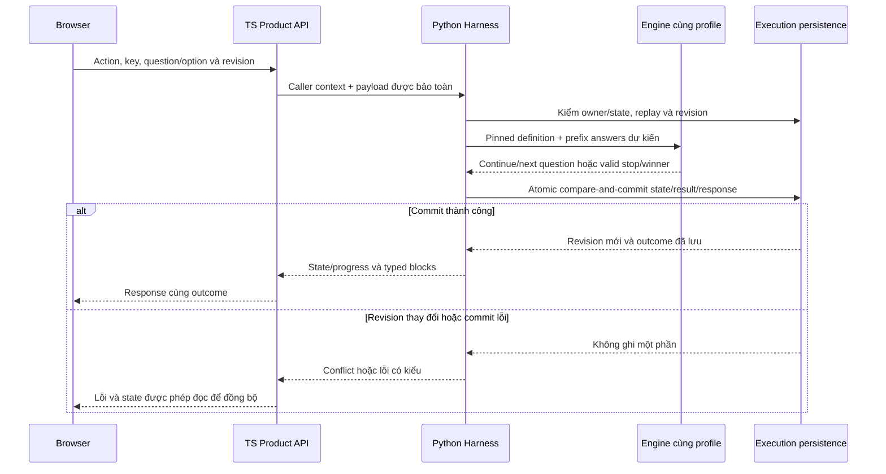

# ĐẶC TẢ CHI TIẾT CONTRACT BOUNDARY & FIXTURES (G0-03 / DEC-07)

Tài liệu này chi tiết hóa các Contract headers, schemas và dữ liệu mẫu (fixtures) dùng chung giữa tầng **TypeScript Product/Studio Layer** và tầng **Python Execution Layer**, phục vụ nghiệm thu **AT-19** và **AT-20**.

**Phạm vi tài liệu:** các snippets là ví dụ thiết kế, không phải bằng chứng schema/runtime đã được đăng ký. [ADR-001](ADR-001-auth-persistence-release-boundary.md) vẫn PROPOSED. Phần 4 bổ sung tác động của [ADR-002](ADR-002-adaptive-riasec-scoring.md) đã được người dùng duyệt về thiết kế; OpenAPI hiện vẫn có constraints sáu câu và chưa được sửa trong đợt soạn docs này.

---

## 1. Giao Thức Xác Thực & Trao Đổi Ngữ Cảnh (Auth & Context Contract)

### 1.1. Client-to-BFF Contract (Browser $\rightarrow$ TypeScript)

* **Cookie Header:** `Cookie: sda_owner=<SIGNED_OPAQUE_TOKEN>`
* **Cookie Attributes:**
  * `HttpOnly`: true (Ngăn XSS truy cập token)
  * `Secure`: true (Chỉ truyền qua HTTPS trên Production)
  * `SameSite`: Lax
  * `Path`: `/api/v1`
  * `Max-Age`: `2592000` (30 ngày)
* **Payload bên trong Token đã ký (HMAC-SHA256):**
  ```json
  {
    "owner_id": "own_01J9K3Z5P08F9V2E3M4X1N8B2Q",
    "iat": 1728810000,
    "exp": 1731402000
  }
  ```

---

### 1.2. Inter-Service Contract (TypeScript BFF $\rightarrow$ Python FastAPI)

Mọi HTTP request từ TS chuyển tiếp sang Python Execution API bắt buộc phải kèm bộ Header nội bộ:

```http
POST /api/v1/internal/conversations/conv_01J9K4A1B2C3D4E5F6G7H8J9K0/turns HTTP/1.1
Host: execution-engine:8000
Content-Type: application/json
X-Internal-Caller: sda-product-bff
X-Correlation-Id: req_01J9K4XYZ987654321
X-Idempotency-Key: idem_01J9K4TURN123456
X-Caller-Context: eyJhbGciOiJIUzI1NiIsInR5cCI6IkpXVCJ9.eyJjYWxsZXJfdHlwZSI6InN0dWRlbnQiLCJvd25lcl9pZCI6Im93bl8wMUo5SzNaNVAwOEY5VjJFM000WDFOOEIyUSIsInVzZXJfaWQiOm51bGwsInJvbGVzIjpbXX0...
```

#### Cấu trúc Payload của `X-Caller-Context` (JWT / Signed Payload):
```json
{
  "caller_type": "student", // "student" | "admin" | "system"
  "owner_id": "own_01J9K3Z5P08F9V2E3M4X1N8B2Q", // Bắt buộc nếu caller_type là student
  "user_id": null, // User ID của Admin (nếu caller_type là admin)
  "roles": [], // e.g. ["admin", "experience_editor"]
  "permissions": [
    "conversation.turn.write",
    "activity.read"
  ],
  "iat": 1728810005,
  "exp": 1728810065 // Token nội bộ có TTL ngắn (60 giây)
}
```

---

## 2. Release Delivery & Pinning Contract (Studio $\rightarrow$ Execution)

### 2.1. Contract Đóng Gói Release Snapshot (`ExperienceReleasePayload`)

Ví dụ dưới đây thuộc bản thiết kế G0-03 trước profile adaptive. `schema_version` ở envelope và tên `holland_dominant_v2` trong ví dụ không xác định schema/profile `riasec.mean.bounds.v2`. Không dùng ví dụ này làm fixture đầy đủ của ngân hàng 30 items.

Khi một bản Release được kích hoạt hoặc đồng bộ sang Execution Engine, payload cấu hình có cấu trúc bất biến:

```json
{
  "experience_id": "exp_personality_v1",
  "release_id": "rel_01J9K5R8T7W6Y5Z4A3B2C1D0EF",
  "version": "1.2.0",
  "content_hash": "sha256:7f83b1657ff1fc53b92dc18148a1d65dfc2d4b1fa3d677284addd200126d9069",
  "schema_version": "2026-10.1",
  "engine_target": "career-assessment-v1",
  "environment": "production",
  "published_at": "2026-10-13T10:00:00Z",
  "published_by": "usr_admin_001",
  "configuration": {
    "title": "Trắc nghiệm Tính cách & Hướng nghiệp ĐBSCL",
    "question_catalog": [
      {
        "id": "q1",
        "dimension": "R_REALISTIC",
        "prompt": "Bạn có thích tự tay sửa chữa dụng cụ hoặc máy móc không?",
        "options": [
          { "value": "A", "label": "Rất thích", "score_vector": { "R": 2 } },
          { "value": "B", "label": "Bình thường", "score_vector": { "R": 1 } },
          { "value": "C", "label": "Không thích", "score_vector": { "R": 0 } }
        ]
      }
    ],
    "scoring_policy": {
      "dimensions": ["R", "I", "A", "S", "E", "C"],
      "classification_algorithm": "holland_dominant_v2"
    }
  }
}
```

### 2.2. Contract Pin Release vào Activity

```json
{
  "activity_id": "act_01J9K6AABBCCDDEEFF00112233",
  "conversation_id": "conv_01J9K4A1B2C3D4E5F6G7H8J9K0",
  "owner_id": "own_01J9K3Z5P08F9V2E3M4X1N8B2Q",
  "activity_type": "personality_assessment",
  "pinned_release_id": "rel_01J9K5R8T7W6Y5Z4A3B2C1D0EF",
  "pinned_content_hash": "sha256:7f83b1657ff1fc53b92dc18148a1d65dfc2d4b1fa3d677284addd200126d9069",
  "status": "in_progress",
  "current_turn": 3,
  "answers_collected": 3,
  "created_at": "2026-10-13T10:15:00Z"
}
```

---

## 3. Fixtures Dùng Chung Cho Kiểm Thử Nghiệm Thu (AT-19 & AT-20)

### 3.1. Fixtures AT-19: Kiểm Tra Quyền Sở Hữu (Ownership & Boundary)

```json
[
  {
    "scenario_id": "FIXTURE_AT19_01_TAMPERED_COOKIE",
    "description": "Cookie bị can thiệp chữ ký nhằm mạo danh owner",
    "request": {
      "path": "/api/v1/conversations/conv_01J9K4A1B2C3D4E5F6G7H8J9K0",
      "headers": {
        "Cookie": "sda_owner=tampered.unsigned.owner_01J9K3Z5P08F9V2E3M4X1N8B2Q"
      }
    },
    "expected_response": {
      "status_code": 401,
      "body": {
        "error_code": "AUTH_INVALID_CREDENTIAL",
        "message": "Thông tin phiên không hợp lệ hoặc đã hết hạn"
      }
    }
  },
  {
    "scenario_id": "FIXTURE_AT19_02_CROSS_OWNER_ACCESS",
    "description": "Owner hợp lệ A cố tình đọc dữ liệu của Owner B",
    "request": {
      "path": "/api/v1/conversations/conv_OF_OWNER_B",
      "headers": {
        "Cookie": "sda_owner=VALID_TOKEN_OF_OWNER_A"
      }
    },
    "expected_response": {
      "status_code": 403,
      "body": {
        "error_code": "FORBIDDEN_RESOURCE_ACCESS",
        "message": "Bạn không có quyền truy cập hội thoại này"
      }
    }
  },
  {
    "scenario_id": "FIXTURE_AT19_03_DIRECT_PYTHON_BYPASS",
    "description": "Gọi trực tiếp vào Engine Python mà không có X-Internal-Caller",
    "request": {
      "path": "http://python-engine:8000/api/v1/conversations/conv_01J9K4A1B2C3D4E5F6G7H8J9K0/turns",
      "headers": {
        "User-Agent": "curl/7.88.1"
      }
    },
    "expected_response": {
      "status_code": 403,
      "body": {
        "error_code": "CALLER_NOT_AUTHORIZED",
        "message": "Truy cập trực tiếp bị từ chối"
      }
    }
  }
]
```

### 3.2. Fixtures AT-20: Release Delivery & Pinning Độc Lập

```json
[
  {
    "scenario_id": "FIXTURE_AT20_01_RELEASE_PINNING",
    "description": "Phiên đang chạy tiếp tục dùng Release cũ sau khi Release mới được kích hoạt",
    "initial_state": {
      "active_release": "rel_v1_hashA",
      "conversation_1": {
        "id": "conv_pinned_v1",
        "pinned_release_id": "rel_v1_hashA",
        "turn": 2
      }
    },
    "trigger_event": {
      "action": "ACTIVATE_NEW_RELEASE",
      "new_release": "rel_v2_hashB"
    },
    "subsequent_action": {
      "path": "/api/v1/conversations/conv_pinned_v1/turns",
      "body": {
        "action": "answer",
        "question_id": "q2",
        "choice": "A"
      }
    },
    "expected_result": {
      "evaluated_against_release": "rel_v1_hashA",
      "next_question_from": "rel_v1_hashA",
      "switched_to_new_release": false
    }
  }
]
```

## 4. Mở rộng contract cho Adaptive RIASEC (ADR-002)

Phần này là **contract đích để phối hợp architecture**, chưa phải schema được runtime/OpenAPI chấp nhận. Thuật toán và policy đầy đủ nằm trong [ADR-002, mục 7](ADR-002-adaptive-riasec-scoring.md); không duy trì công thức khác ở tầng TS.

Đọc ADR-002 mục 8 (ví dụ contract/state transitions) cho các payload và mục 9 (ma trận truy vết) để đối chiếu FR/AT và schema hiện có.

### 4.1. Nhận diện profile và compatibility

| Định danh | Giá trị thiết kế | Ý nghĩa |
|---|---|---|
| Activity type | `personality_assessment_adaptive` | Phân biệt với activity sáu câu `personality_assessment` |
| Assessment definition schema | `2.0` | Cấu trúc ngân hàng/rating/coverage của definition mới |
| Algorithm profile | `riasec.mean.bounds.v2` | Behavior scoring/selection/stop của ADR-002 |
| Activity view, assessment_question và assessment_clarification | Schema version `2` cho profile adaptive | Hai block có progress cần phân biệt với version 1 cố định sáu câu; choices nằm trong question, không tạo block choices riêng |
| PersonalityCard/ShareCard | Giữ schema/projection hiện có nếu đúng allowlist | Card vẫn một House; ShareCard `summary.v1` không mang internal scores |
| Engine version | Version được Python đăng ký và report xác nhận | Không suy ra engine đã hỗ trợ chỉ từ suffix `v2` của profile |

Schema của release delivery envelope là một định danh riêng; không đồng nhất với definition schema `2.0`. Content hash phải bao phủ definition và những policy bất biến thuộc release theo canonicalization đã được hai plane thống nhất. Cùng content hash nhưng profile/engine không được report hỗ trợ vẫn không được coi là evaluation pass.

Proposal cho `CreateConversationInput` ở `POST /conversations` bổ sung `accepted_activity_profiles`, là danh sách profiles client hiểu, đi cùng `supported_blocks` đã có. Nếu không khai báo profiles thì mặc định chỉ profile sáu câu; nếu không khai báo supported_blocks thì mặc định bộ blocks v1. Client tự khai báo capability không cấp quyền auth hoặc quyền chọn release khác.

Manifest của `riasec.mean.bounds.v2` yêu cầu client hiểu Activity view version 2 và đủ bộ blocks: `text` version 1, `assessment_question` version 2, `assessment_clarification` version 2, `personality_card` version 1. Khai báo profile này đồng nghĩa client hiểu Activity view version 2; khai báo profile không tự bổ sung hoặc ghi đè supported_blocks. Nếu khai báo adaptive nhưng thiếu một block bắt buộc, bootstrap trả incompatibility trước khi tạo conversation/preview; không âm thầm nâng version hoặc hạ profile.

TS chuyển tiếp cả hai khai báo nguyên vẹn. Python xác minh support và lưu snapshot capability trong conversation khi tạo. Mọi activity khởi tạo qua Agent/message hoặc structured turn đều đọc snapshot này và kiểm profile của release cùng manifest trước khi commit. Không giả định có endpoint tạo Activity độc lập. Turns, retry hoặc LLM intent không được tự mở rộng capability. GET/reload dùng snapshot đã lưu; client không hiểu version phải dừng thao tác có kiểm soát, không làm server downgrade activity đã pin.

Preview bootstrap `POST /admin/experiences/{id}/previews` cũng cần input riêng kết hợp snapshot-command hiện có với accepted_activity_profiles và supported_blocks, lưu capability trên preview conversation cùng draft snapshot. Defaults/checks giống conversation thật; không truyền capability UI vào validation/evaluation commands không tạo preview. Preview turns không được bỏ qua negotiation chỉ vì caller là Admin.

Conversation legacy thiếu capability vẫn có thể dùng chat/profile cũ; nếu Agent muốn bắt đầu adaptive thì trả incompatibility trước khi tạo activity mới. Report/response báo incompatibility có kiểu; ID lỗi được đồng bộ trong OpenAPI ở đợt riêng. Không tự đổi sang profile cũ, không downgrade release đã pin.

### 4.2. Quyền sở hữu dữ liệu và kết quả

| Dữ liệu/việc xử lý | Chủ sở hữu | Điều kiện |
|---|---|---|
| Definition, bank 30 items, metadata, tie order, release pointer | TS Product/Studio | Draft có revision; published release bất biến |
| Definition validation, golden evaluation, scoring, bounds, selector, stop | Python engine | Cùng behavior version cho runtime/preview/evaluation |
| Active answers, current question, activity revision, proposals, result validity | Python Harness/persistence | Owner/revision/idempotency được kiểm trước commit |
| Sums/counts/exact means/contributions và lý do dừng | Python result snapshot | Refs/hash/profile/engine đủ replay |
| Progress và card UI | Browser, từ state server | Không tự tính điểm hoặc tự quyết định completed |
| ShareCard | Projection từ valid result | Closed allowlist; không xuất scores/bounds/answers ra ảnh |

R/I/A/S/E/C là ký hiệu chiều đánh giá trong tài liệu. `house_id` trong question/result/card phải tham chiếu cùng House metadata của release; không thay ID của metadata bằng ký hiệu hoặc theme của UI khi proxy/render.

### 4.3. Progress biến thiên

Ví dụ fragment của Activity view adaptive sau 14 active scored answers:

```json
{
  "schema_version": 2,
  "activity_type": "personality_assessment_adaptive",
  "algorithm_profile": "riasec.mean.bounds.v2",
  "status": "in_progress",
  "progress": {
    "completed": 14,
    "min_total": 12,
    "max_total": 30,
    "total": null,
    "phase": "adaptive"
  }
}
```

Đây là fragment minh họa, không phải ActivityView hoàn chỉnh. `completed` đếm active scored answers, không đếm tên, chat tự do, clarification hoặc retry. `total=null` trước khi có result; khi completed, total bằng số answers thực tế. End/expiry trước completion giữ phase/count gần nhất và không tạo total giả hoặc valid card.

UI hiển thị “Đã trả lời 14 câu; đang làm rõ kết quả”. Không biểu diễn 14/30 như lời hứa rằng chắc chắn cần thêm 16 câu. Khi edit cắt suffix, count và phase có thể giảm; client dùng state mới từ server.

### 4.4. Một lượt answer/edit và commit



Engine tính ngoài transaction chỉ được commit nếu expected revision và điều kiện end/expiry vẫn hợp lệ. Retry sau response bị mất đọc lại outcome đã lưu, không chạy thêm answer. Edit giữ prefix tới câu k, thay option k, bỏ suffix và vô hiệu proposal/result/card cũ trong cùng mutation; engine recompute trên prefix mới.

Release snapshot thiếu/không hỗ trợ, option không thuộc question, prefix sai hoặc engine failure không được tạo completed/result. LLM lỗi dùng option/template flow; text chưa confirmed không commit rating. Replay của request cũ không được khôi phục latest validity của result đã bị edit vô hiệu hóa; thao tác đọc/export vẫn kiểm validity/revision hiện hành.

### 4.5. Evaluation report, pinning và các ca contract cần có

Report adaptive phải gắn đúng content hash, definition schema, algorithm profile, engine version và mandatory case IDs/outcomes. Đổi draft hoặc profile làm report cũ không còn khớp; technical validation không thay phê duyệt nội dung/chuyên môn.

| Case tài liệu | Expected behavior |
|---|---|
| Client không khai báo adaptive | Không tạo adaptive activity ngầm; incompatibility có kiểu nếu release yêu cầu profile mới |
| Client khai báo adaptive nhưng chỉ blocks v1 | Bootstrap bị từ chối; không coi accepted_activity_profiles là quyền ghi đè supported_blocks |
| Start qua message/Agent hoặc preview turns | Kiểm snapshot capability đã lưu trước commit; không có đường start bỏ qua manifest |
| Activity v1 đang chạy khi v2 được activate | Giữ release/schema/behavior v1; không đổi total=6 hoặc thứ tự câu |
| Adaptive early stop tại 18 | Completed có đúng 18 active answers, total=18 và một valid House/card |
| Adaptive chưa rõ tại 18 | In_progress, total=null, selector phát câu hợp lệ tiếp theo |
| Đủ 30 và hòa | Một House theo tie policy đã pin; không hỏi câu 31 |
| Edit completed | Suffix và result cũ mất hiệu lực; state mới theo recomputed stop, revision tăng đúng một mutation |
| Key replay sau edit khác | Trả outcome replay nhưng không coi card cũ là latest valid để export |
| Report đúng hash nhưng sai profile/engine | Không dùng để vượt publish gate |
| Draft đổi sau tạo preview | Preview tiếp tục dùng draft snapshot đã pin, không tác động activity/release thật |
| Snapshot release không khả dụng | Lỗi có kiểu, không chuyển active release khác và không tạo result giả |

Danh sách trên là acceptance criteria cần có khi đồng bộ contract, không phải fixtures/tests đã được triển khai. Profile mới không đổi auth/owner policy của phần 1, không tự chốt các tham số vận hành còn thuộc quyết định riêng.

