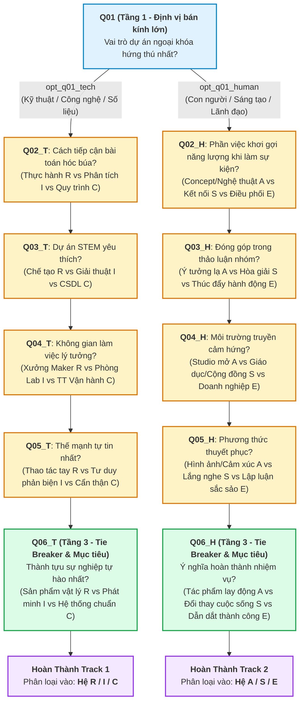

# Đặc Tả Kỹ Thuật: Quy Tắc Phân Loại 6 Hệ & Cây Phân Nhánh Thích Ứng (Task G0-04)

> **Mã nhiệm vụ:** `G0-04`  
> **Module phụ trách:** `M-ENG` (Engine), `M-EVL` (Validator/Evaluation)  
> **Người thực hiện (PIC):** **Nam Tran Thanh**
> **Trạng thái:** **Completed (Sẵn sàng review)**  
> **Tệp dữ liệu fixture tham chiếu:** `demo_experience_definition.json` 
> **Tệp script kiểm thử độc lập:** `verify_simulation.mjs`

---

## 1. Bối Cảnh & Mục Tiêu Nghiệp Vụ

Nhằm phục vụ bài trắc nghiệm hướng nghiệp cho học sinh THPT (lớp 10–12) tại Đồng bằng sông Cửu Long (dự án **IHRD GenZ Career Agent**), hệ thống cần phân loại học sinh vào **6 Hệ tính cách** (bản địa hóa từ mô hình Holland RIASEC).

Theo thỏa thuận kiến trúc API (OpenAPI Contract tại `experience-api.yaml`), phiên bản MVP giới hạn bài trắc nghiệm trong **đúng 6 câu hỏi tương tác**. Để vừa đảm bảo số lượng câu hỏi ngắn gọn trên thiết bị di động, vừa đạt độ chính xác cao trong phân loại, thuật toán áp dụng cơ chế **Phễu thích ứng 3 tầng (Multistage Adaptive Branching)** kết hợp **Tính điểm xác định (Deterministic Scoring)** 100%.

---

## 2. Chuẩn Hóa Định Danh 6 Hệ Tính Cách (Houses Taxonomy)

Mỗi Hệ tương ứng với một House trong hệ thống với metadata bất biến phục vụ chiếu dữ liệu ra `PersonalityCard` và `ShareCard`:

| House ID | Tên Hệ (Tiếng Việt & Anh) | Mascot Ref | Theme Ref | Nhóm ngành nghề tiêu biểu gợi ý |
|---|---|---|---|---|
| **`house_r`** | **Hệ Khám Phá** (Realistic) | `mascot_phoenix_maker` | `theme_realistic_crimson` | Cơ điện tử & Robot, Kỹ thuật Ô tô, Nông nghiệp Công nghệ cao, Kỹ thuật Công trình. |
| **`house_i`** | **Hệ Tư Duy** (Investigative) | `mascot_owl_sage` | `theme_investigative_sapphire` | Khoa học Dữ liệu & AI, Khoa học Máy tính, Công nghệ Sinh học, Phân tích Tài chính. |
| **`house_a`** | **Hệ Sáng Tạo** (Artistic) | `mascot_chameleon_artist` | `theme_artistic_amber` | Thiết kế Đồ họa & Đa phương tiện, Truyền thông & Báo chí, Thiết kế Game, Kiến trúc. |
| **`house_s`** | **Hệ Gắn Kết** (Social) | `mascot_dolphin_healer` | `theme_social_emerald` | Sư phạm & Giáo dục Đổi mới, Tâm lý học, Công tác Xã hội, Quản trị Nhân lực, Y - Điều dưỡng. |
| **`house_e`** | **Hệ Tiên Phong** (Enterprising) | `mascot_lion_leader` | `theme_enterprising_ruby` | Quản trị Kinh doanh & Khởi nghiệp, Marketing, Thương mại Quốc tế, Tài chính Doanh nghiệp. |
| **`house_c`** | **Hệ Chu Toàn** (Conventional) | `mascot_beaver_curator` | `theme_conventional_amethyst` | Kế toán & Kiểm toán, Phân tích Nghiệp vụ (BA), Quản trị Hệ thống Thông tin, Luật Hành chính. |

---

## 3. Kiến Trúc Cây Phân Nhánh Thích Ứng (2 Branching Paths)

Thay vì cho học sinh làm bài test phẳng, hệ thống tổ chức ngân hàng 11 câu hỏi thành cây quyết định 3 tầng, đảm bảo **mọi hành trình đều đi qua chính xác 6 câu hỏi**:

---

## 4. Mô Hình Tính Điểm Xác Định (Deterministic Scoring Formula)

### 4.1. Công Thức Tính Điểm
Giả sử học sinh hoàn thành tập hợp 6 câu trả lời:
$$\mathcal{A} = \{(q_1, o_1), (q_2, o_2), \dots, (q_6, o_6)\}$$

Với mỗi lựa chọn $o_i$ của câu hỏi $q_i$, ma trận trọng số $W(o_i, h) \ge 0$ phân bổ điểm số cho từng Hệ $h \in \mathcal{H} = \{\text{house\_r}, \text{house\_i}, \text{house\_a}, \text{house\_s}, \text{house\_e}, \text{house\_c}\}$.

1. **Tổng điểm của mỗi Hệ:**
   $$\text{Score}(h) = \sum_{i=1}^{6} W(o_i, h)$$

2. **Phần trăm đóng góp (Contribution Percentage):**
   $$\text{Contrib}(h) = \frac{\text{Score}(h)}{\sum_{k \in \mathcal{H}} \text{Score}(k)} \times 100\%$$

3. **Hệ Tính Cách Chủ Đạo (Primary House):**
   $$h^* = \arg\max_{h \in \mathcal{H}} \text{Score}(h)$$

---

## 5. Chính Sách Giải Quyết Hòa Điểm (Tie-Breaking Policy theo DEC-04)

Trong trường hợp có từ 2 Hệ trở lên đạt điểm số tối đa bằng nhau:
$$\mathcal{H}_{\text{tie}} = \{ h \in \mathcal{H} \mid \text{Score}(h) = \max_{k} \text{Score}(k) \}, \quad |\mathcal{H}_{\text{tie}}| \ge 2$$

Hệ thống áp dụng chính sách ưu tiên tuần tự (Deterministic Resolution):

1. **Ưu tiên 1 (Stage 3 Weight):** Xét tổng điểm nhận được tại câu hỏi Tầng 3 (Q06_T hoặc Q06_H). Hệ nào nhận được điểm ở câu này sẽ chiến thắng.
2. **Ưu tiên 2 (Stage 2 Weight):** Nếu vẫn hòa, xét tổng điểm lũy kế tại các câu hỏi Tầng 2 (Q02 đến Q05).
3. **Ưu tiên 3 (Hexagonal Order):** Nếu vẫn tiếp tục hòa điểm tuyệt đối, áp dụng thứ tự vòng quay chuẩn của lục giác Holland RIASEC:
   $$\text{house\_r} \longrightarrow \text{house\_i} \longrightarrow \text{house\_a} \longrightarrow \text{house\_s} \longrightarrow \text{house\_e} \longrightarrow \text{house\_c}$$

> **Nguyên tắc bảo đảm:** Tuyệt đối không sử dụng hàm `random()` hay phụ thuộc vào LLM để giải quyết hòa điểm. Kết quả luôn tái lập chính xác 100%.

---

## 6. Chính Sách Sửa Đáp Án & Vô Hiệu Hóa Trạng Thái (DEC-01 State Invalidation)

Học sinh được phép quay lại sửa đáp án của câu hỏi thứ $k$ ($1 \le k \le 6$):
1. **Thu hồi nhánh downstream:** Khi câu hỏi $q_k$ nhận đáp án mới $o'_k$, toàn bộ các câu hỏi từ $k+1$ đến 6 và các câu trả lời tương ứng sẽ bị vô hiệu hóa (`status: invalidated`).
2. **Điều hướng lại cây phân nhánh:**
   * Nếu sửa câu $Q01$ từ `opt_q01_tech` sang `opt_q01_human`, hệ thống tự động loại bỏ nhánh `Q02_T..Q06_T` và chuyển hướng sinh câu hỏi tiếp theo là `Q02_H`.
3. **Thu hồi Result/Card:** Nếu activity đã ở trạng thái `completed`, kết quả và thẻ cũ bị đánh dấu `invalidated`, `result_revision` tăng lên và tính toán lại từ đầu sau khi học sinh trả lời đủ 6 câu mới.

---

## 7. Bằng Chứng Kiểm Thử Độc Lập (Verification & Test Runs)

Đã khởi tạo kịch bản kiểm thử độc lập tại `verify_simulation.mjs` chạy qua tệp cấu hình `demo_experience_definition.json`.

### Kết quả chạy kiểm thử tự động:
* **Kiểm tra tính toàn vẹn Schema:** Đạt chuẩn 100% các ràng buộc OpenAPI (`schema_version: "1.0"`, 11 questions, 6 houses, regex patterns hợp lệ).
* **Kết quả 4 Golden Evaluation Cases:**
  * `case_golden_track1_realistic`: Duyệt đúng 6 câu Track 1 $\to$ Điểm $R=15, I=2, C=2$ $\to$ Phân loại: **`house_r`** (**PASS**).
  * `case_golden_track1_investigative`: Duyệt đúng 6 câu Track 1 $\to$ Điểm $I=15, R=3, C=1$ $\to$ Phân loại: **`house_i`** (**PASS**).
  * `case_golden_track2_artistic`: Duyệt đúng 6 câu Track 2 $\to$ Điểm $A=15, E=2, S=2$ $\to$ Phân loại: **`house_a`** (**PASS**).
  * `case_golden_track2_social_tie_break`: Kịch bản giằng co điểm giữa S và E $\to$ Q06_H giải quyết hòa điểm dứt khoát $\to$ Điểm $S=10, E=7, A=2$ $\to$ Phân loại: **`house_s`** (**PASS**).
* **Kiểm tra mô phỏng DEC-01:** Đổi đáp án câu Q01 $\to$ Nhánh chuyển động tức thời từ Track 1 sang Track 2 (**PASS**).
